# orrery — feature guide

A tour of the console in pictures: what each part is, why it exists, and how it fits the whole. Every picture was taken on 2026-10-20 by `tools/feature-guide.mjs` from the release binary built from this checkout. Run `node tools/feature-guide.mjs` after `cargo build --release` to take them again.

> **Nothing here is a real fleet.** The wall and the museum interface show the **demo fixture** (`--demo`, `fleet::demo_doc()` in `src/fleet.rs`): eight made-up nodes called `museum-01` to `museum-08`, made-up 10.0.0.x addresses, and one made-up stranger. The seat in part 5 dials a **simulated node**: a small RFB server inside the capture script that draws a made-up exhibit screen on 127.0.0.1. The museum interface is drawn by `--frame`, the program's own way to render a window without a compositor; it is the same drawing code as `--gui`, not a photograph of a live window. Every orrery in the script runs with an empty `HOME`, so no `answers.txt`, key or certificate was read.

For what each module does and why, read the [README](../README.md); for the design, start at [console.md](console.md).

## Contents

1. [Start here: one read model, three faces](#part-1)
2. [The wall: eight nodes at a glance](#part-2)
3. [Two postures: gallery and operator](#part-3)
4. [The wall's seat panel](#part-4)
5. [The seat: one node, in your terminal](#part-5)
6. [The museum interface: a room of machines](#part-6)
7. [Exchange and Media: files, and the cards](#part-7)
8. [The verbs](#part-8)
9. [Underneath: no dependencies, and the wire](#part-9)
10. [What the pictures found](#part-10)
11. [How it fits together](#part-11)

<a id="part-1"></a>
## 1. Start here: one read model, three faces

**Why it exists.** A Copal fleet is a room of small machines on a LAN with no internet. The people who look at it are not all the same: a gallery screen, a phone on a lanyard, and an operator at a desk. orrery gives each of them a face, and gives all of them the same facts.

**How it fits.** Every face renders one document, `copal fleet state`, and nothing else. A node that is not in that document cannot be drawn, selected or dialled. There is no second way of knowing anything.

The user process, start to finish:

```sh
cargo build --release                                  # no dependencies to fetch

# try it with no fleet at all
./target/release/orrery --demo                         # the wall, on 127.0.0.1:8080
./target/release/orrery --gui --demo --operator x      # the museum interface

# against a fleet
./target/release/orrery --listen 0.0.0.0:8080          # the wall, for the gallery screen
./target/release/orrery --gui --operator x --copal ~/code/copal-alpine-linux
./target/release/orrery --seat museum-01               # one node, in this terminal
```

| Face | Command | Who it is for |
| --- | --- | --- |
| **the wall** | `orrery --listen` | the gallery screen and a phone: a web page served by the warden |
| **the seat** | `orrery --seat ID` | one node, full screen, in the terminal you are already in |
| **the museum interface** | `orrery --gui` | the operator: a native window, Wayland on a node and AppKit on a Mac |

<a id="part-2"></a>
## 2. The wall: eight nodes at a glance

**Why it exists.** The lab report asked for a picture of the whole room that a visitor's screen and an operator's phone can both open. It must be cheap: the wall is one HTML file with no CDN and no build step, and the server is a thread per connection with no executor.

**How it fits.** The page polls `/api/state` every five seconds. That route runs `copal fleet state --json` and forwards the document. The page draws it and adds nothing of its own.

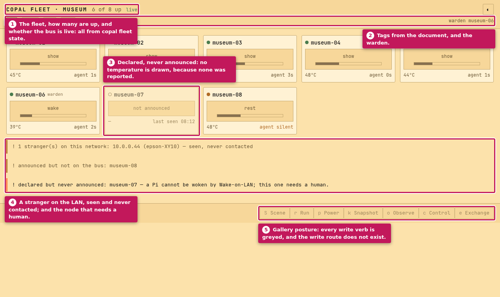

*Picture 1. The wall in the gallery posture (`orrery --demo`).*

1. The fleet, how many are up, and whether the bus is live: all from `copal fleet state`.
2. Tags from the document, and the warden.
3. Declared, never announced: no temperature is drawn, because none was reported.
4. A stranger on the LAN, seen and never contacted; and the node that needs a human.
5. Gallery posture: every write verb is greyed, and the write route does not exist.

The tile keeps three kinds of absence apart: *not reported* is not 0 °C, and *never heard from* is not "agent 0s". A tile with no thumbnail turns into a band with the readings that are real. It does not show an empty 16:9 box shaped like the missing picture.

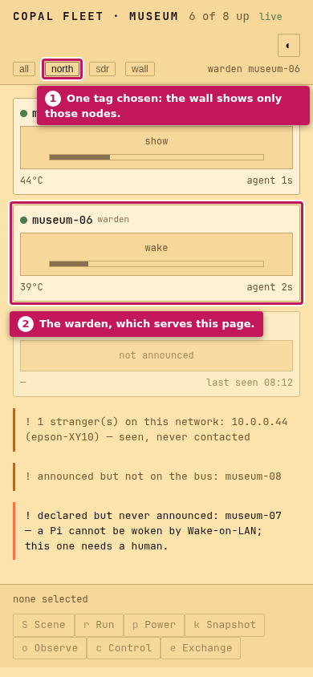

*Picture 2. The same page at phone width, with the `north` chip pressed.*

1. One tag chosen: the wall shows only those nodes.
2. The warden, which serves this page.

**Check yourself**

- Can you tell a node that never announced from one whose agent went quiet? (Hollow dot and *last seen*; amber *agent silent*.)
- Where would a printer that joined the LAN appear? (In the note under the tiles, never as a tile.)

<a id="part-3"></a>
## 3. Two postures: gallery and operator

**Why it exists.** Read-mostly is a default, not a ceiling. A gallery screen is a machine the public stands in front of; an operator needs to change scenes and power nodes off. So there are two postures, and the difference is structural rather than a hidden button.

**How it fits.** Without `--operator TOKEN` the write route **does not exist**: `POST /api/verb` answers 404, the same as any made-up path, because a route that says "forbidden" tells a scanner it is there. With a token the route checks it, checks the verb against the allow-list in `src/verbs.rs`, checks every argument's shape, and checks every node id against the document `copal fleet state` just returned. Nothing from a request is ever put into a command line; the CLI gets argv directly and never a shell.

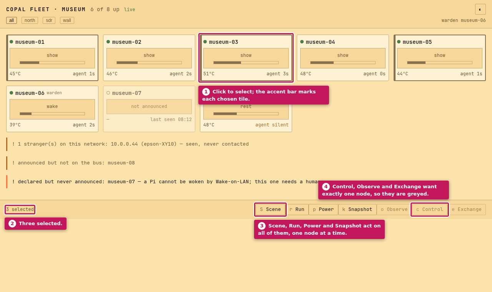

*Picture 3. `orrery --demo --operator TOKEN`, with three tiles clicked.*

1. Click to select; the accent bar marks each chosen tile.
2. Three selected.
3. Scene, Run, Power and Snapshot act on all of them, one node at a time.
4. Control, Observe and Exchange want exactly one node, so they are greyed.

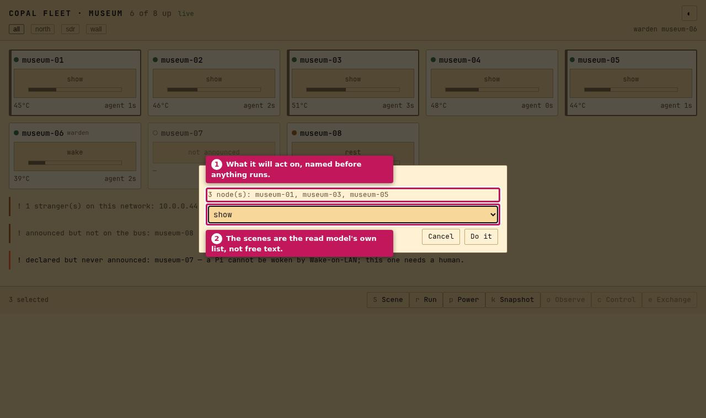

*Picture 4. Pressing Scene (`S`).*

1. What it will act on, named before anything runs.
2. The scenes are the read model's own list, not free text.

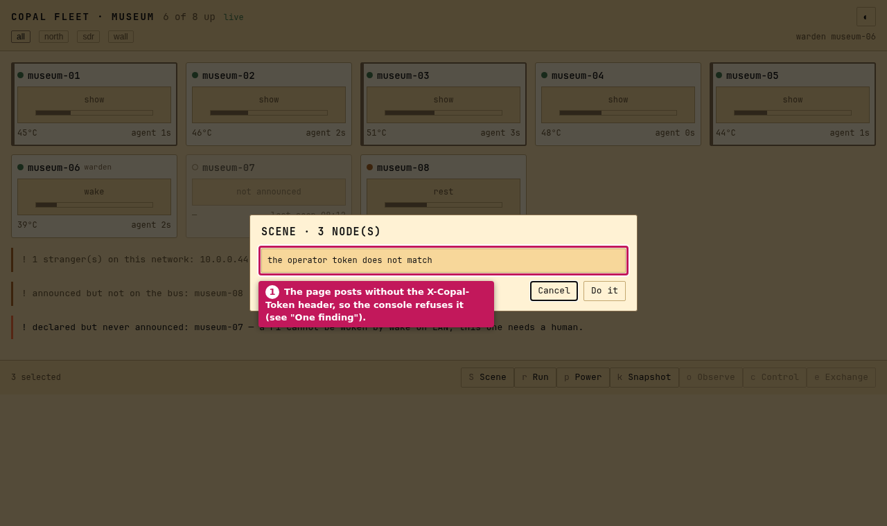

*Picture 5. The answer the page shows today.*

1. The page posts without the `X-Copal-Token` header, so the console refuses it. See [part 10](#part-10).

The same request with the token, sent by hand to the same demo console. The CLI runs once per node, and each node gets its own line:

```sh
$ curl -s -X POST -H 'X-Copal-Token: demo-token' \
    -d '{"verb":"scene","arg":"show","nodes":["museum-01","museum-03"]}' \
    http://127.0.0.1:8181/api/verb
{"code":0,"output":"museum-01    ok\n             demo: would have run `copal fleet scene --node museum-01 show`\nmuseum-03    ok\n             demo: would have run `copal fleet scene --node museum-03 show`", ...}
```

And the boundary refusing what it should:

```text
arg "show; rm"      -> {"error":"not a usable name: \"show; rm\""}
node "epson-XY10"   -> {"error":"no such node in this fleet: epson-XY10"}
```

**Check yourself**

- Why is the write route a 404 and not a 403 in the gallery posture?
- Which verbs refuse a selection of more than one node, and why? (Control: broadcasting keystrokes to eight machines makes divergent state nobody can see. Scene and Run are what is actually wanted.)

<a id="part-4"></a>
## 4. The wall's seat panel

**Why it exists.** A double-click on a tile opens one node's facts. The wall **does not proxy VNC**: eight live sessions on 512 MB boards were priced and refused, so the page hands the browser the node's own server when one is published, and says so plainly when none is.

**How it fits.** Esc always goes back to the wall, and never asks. The facts are the same fields as the read model; nothing is collected by the page.

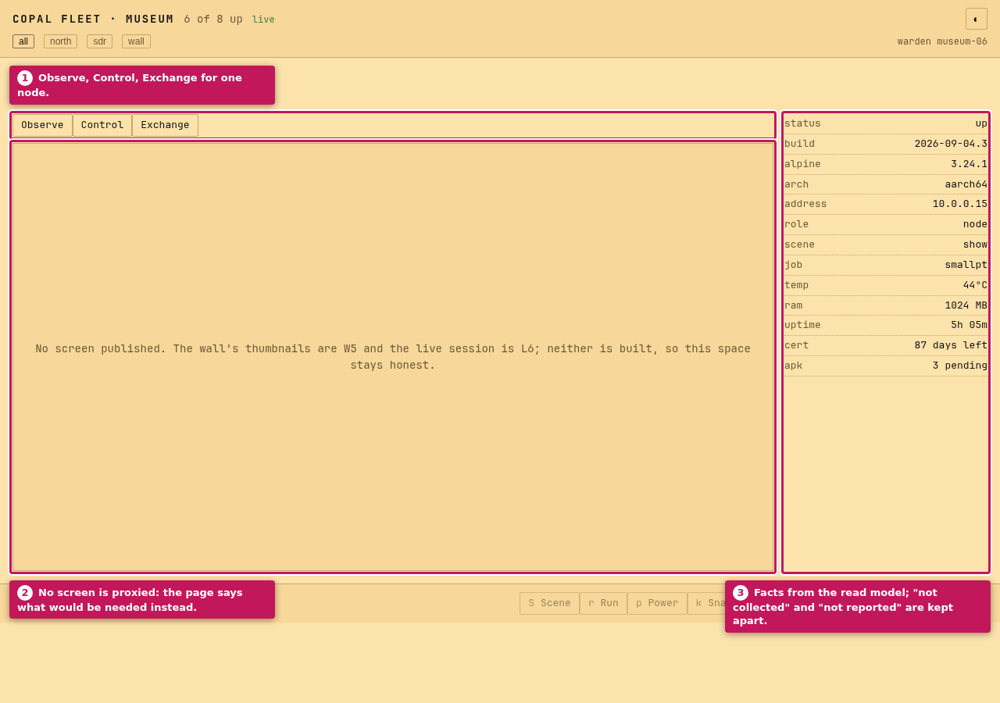

*Picture 6. museum-05's panel on the wall.*

1. Observe, Control, Exchange for one node.
2. No screen is proxied: the page says what would be needed instead.
3. Facts from the read model; "not collected" and "not reported" are kept apart.

<a id="part-5"></a>
## 5. The seat: one node, in your terminal

**Why it exists.** The wall is eight nodes at a glance. Sometimes the job is one node, full screen, from a shell you already have open, perhaps over ssh, with no browser. That is `orrery --seat ID`.

**How it fits.** The seat looks the node up in `copal fleet state` and refuses a name the document does not list. It then speaks RFB to that node's screen. It uses security type `none`, or VNC authentication with the fleet's screen password from the copal checkout's `answers.txt`. It asks for Raw and CopyRect only, because every compressed encoding wants zlib. It draws with half-blocks (`U+2580`, 24-bit colour) anywhere, and with sixel where the terminal has it. The default is 6 frames a second, because frame rate is the expensive axis.

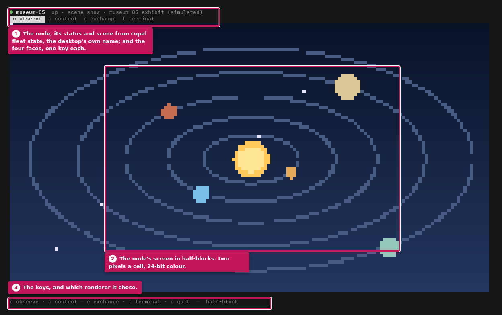

*Picture 7. `orrery --seat museum-05 --half-block`, against the **simulated** node (the exhibit picture is drawn by the capture script, not by a real machine).*

1. The node, its status and scene from `copal fleet state`, the desktop's own name; and the four faces, one key each.
2. The node's screen in half-blocks: two pixels a cell, 24-bit colour.
3. The keys, and which renderer it chose.

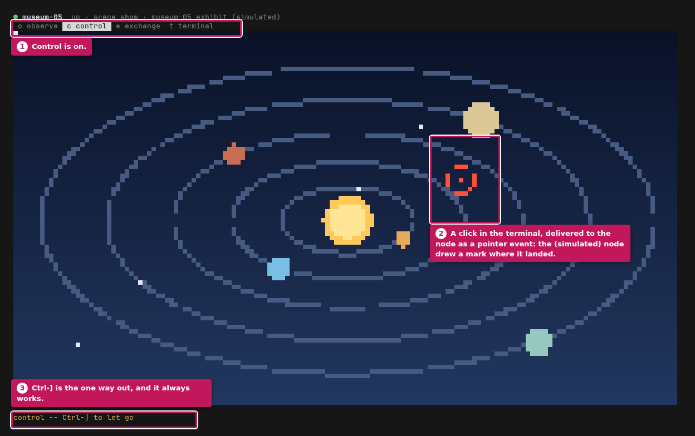

*Picture 8. After `c`, and one click in the terminal.*

1. Control is on.
2. A click in the terminal, delivered to the node as a pointer event: the (simulated) node drew a mark where it landed.
3. Ctrl-] is the one way out, and it always works.

| Key | Face | In the seat |
| --- | --- | --- |
| `o` | Observe | the node's screen, read-only |
| `c` | Control | keyboard and pointer as well; `Ctrl-]` lets go |
| `e` | Exchange | not built here; the native window has it |
| `t` | Terminal | not built here; the native window has it |
| `q` | | quit, and the terminal is put back exactly as it was |

**Check yourself**

- What does the seat do if the window is too small to draw in? (It says so and still reads `q`: being stuck inside a machine is the one thing a seat may not do.)
- Where does the screen password come from, and why is VNC authentication kept out of `profile.rs`? (It is 56-bit DES and an eight-character password: a lock, not security.)

<a id="part-6"></a>
## 6. The museum interface: a room of machines

**Why it exists.** This is what the lab report described before either of the other faces was built: a room of machines you select from, and a row of verbs that act on the selection. A computer lab, with the computers in it. It runs on the operator's own machine, so it does not disappear when the warden does.

**How it fits.** It is `--gui`: a Wayland client on a node and an AppKit window on a Mac, behind one `Surface` trait. The drawing is all software into a flat array of pixels, with two bitmap faces of *misc-fixed* baked into `src/font.rs`. The selection is the only state it keeps. Everything else is a rendering of the last read model.

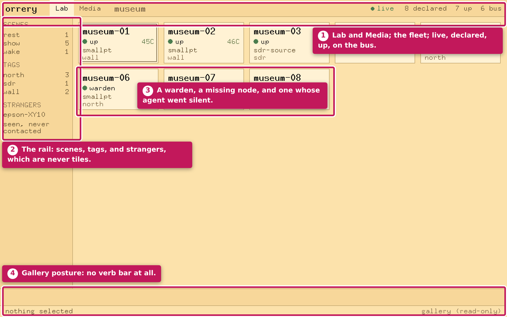

*Picture 9. `--frame` of the Lab, gallery posture.*

1. Lab and Media; the fleet; live, declared, up, on the bus.
2. The rail: scenes, tags, and strangers, which are never tiles.
3. A warden, a missing node, and one whose agent went silent.
4. Gallery posture: no verb bar at all.

In the gallery posture the verb dispatch table is **empty**. A keystroke that would have been a verb finds nothing to call. "The button is hidden" is not a security property.

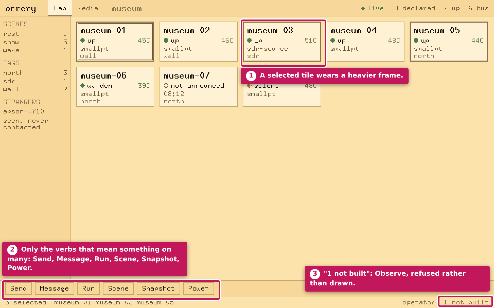

*Picture 10. Operator posture, three nodes selected.*

1. A selected tile wears a heavier frame.
2. Only the verbs that mean something on many: Send, Message, Run, Scene, Snapshot, Power.
3. "1 not built": Observe, refused rather than drawn.

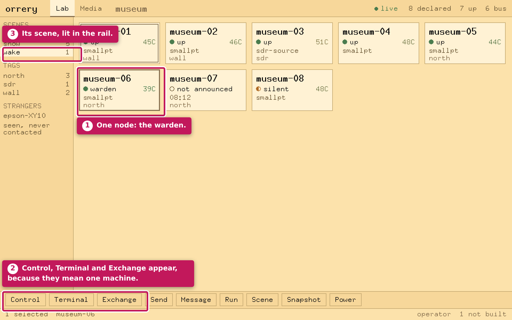

*Picture 11. Operator posture, the warden selected.*

1. One node: the warden.
2. Control, Terminal and Exchange appear, because they mean one machine.
3. Its scene, lit in the rail.

A verb that cannot apply is **absent rather than greyed**. The bar is redrawn every time the selection changes, and the status line says how many verbs are not built. There is one pane at a time and never a window inside the window.

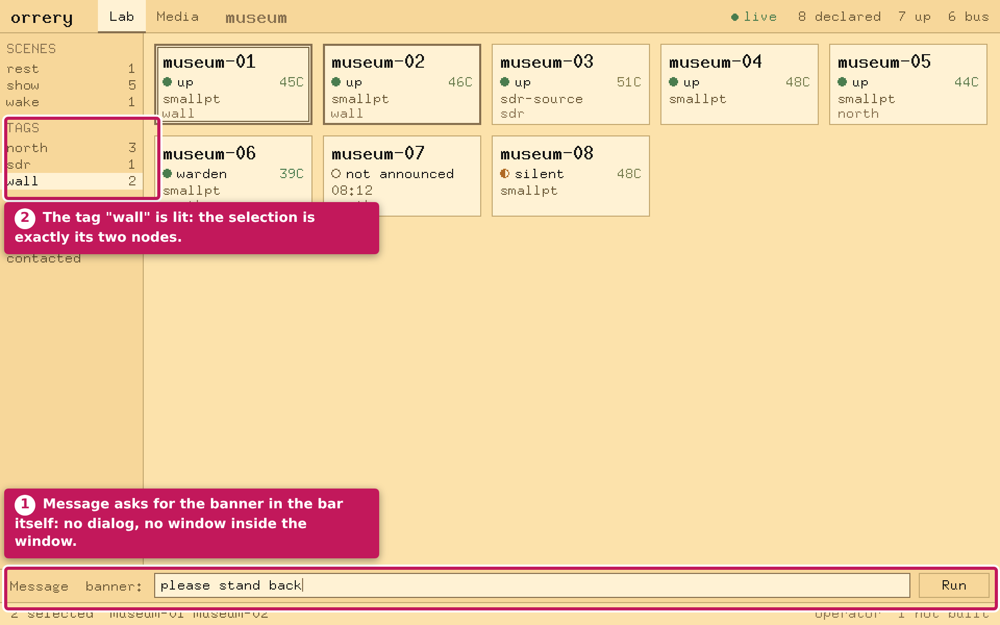

*Picture 12. Message (`m`) on the two nodes tagged `wall`.*

1. Message asks for the banner in the bar itself: no dialog, no window inside the window.
2. The tag "wall" is lit: the selection is exactly its two nodes.

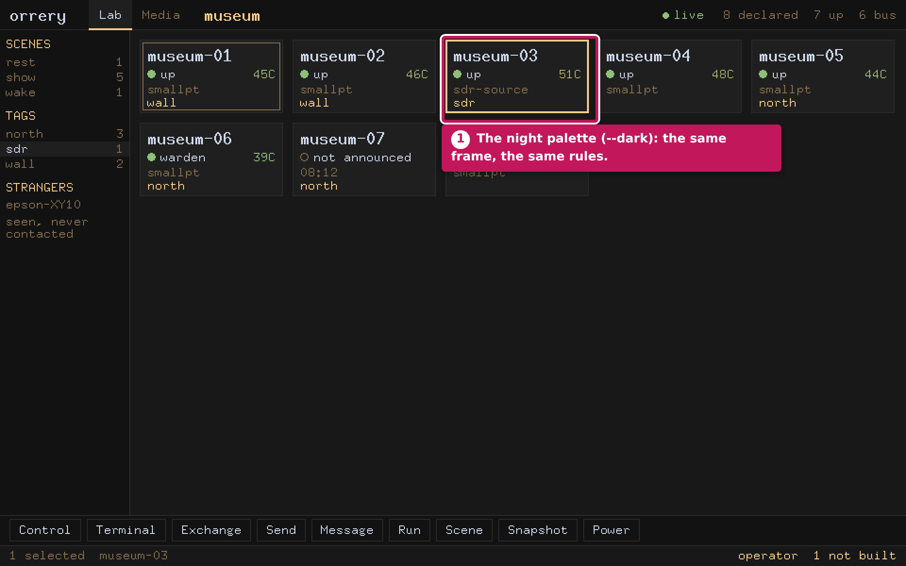

*Picture 13. The same Lab with `--dark`.*

1. The night palette (`--dark`): the same frame, the same rules.

**Check yourself**

- How do you select everything running the `show` scene without clicking eight tiles? (Click `show` in the rail.)
- Why can a stranger never be the target of a verb? (It is drawn as a row with no selection box, so the refusal is in the structure, not a check.)

<a id="part-7"></a>
## 7. Exchange and Media: files, and the cards

**Why it exists.** Two jobs an operator does by hand: moving a file onto a node, and writing the SD card for the next one. Exchange is a two-pane file browser over SFTP on the same SSH connection the operator's certificate opens. Media is the card ledger: which card carries which token, which have been written, and a pane that runs `copal-prep.sh` on a real terminal.

**How it fits.** Both open as panes in the same window (`Cmd-1` and `Cmd-2` switch between Lab and Media). Media does not write a card itself. `copal-prep.sh` picks the disk and asks for both typed `ERASE` confirmations, and that is its whole safety model. Nothing is answered for you and there is no `--yes`.

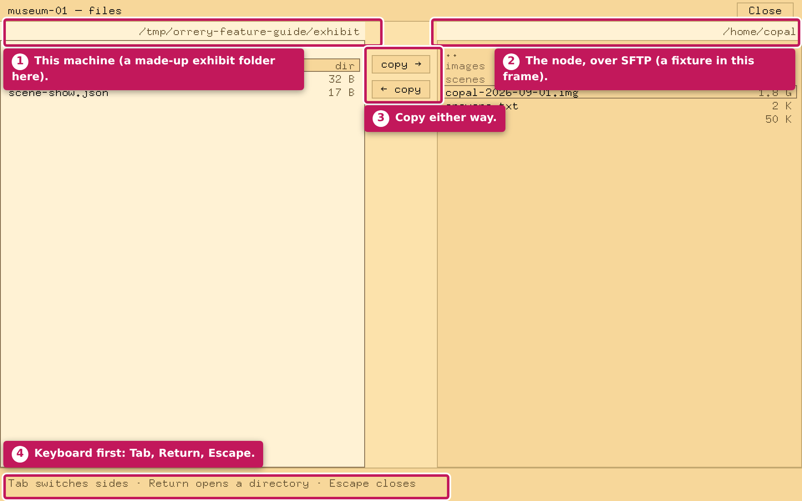

*Picture 14. `--frame-view files`. The left side is a made-up exhibit folder made by the capture script; the right side is the frame's own fixture, not a connection.*

1. This machine (a made-up exhibit folder here).
2. The node, over SFTP (a fixture in this frame).
3. Copy either way.
4. Keyboard first: Tab, Return, Escape.

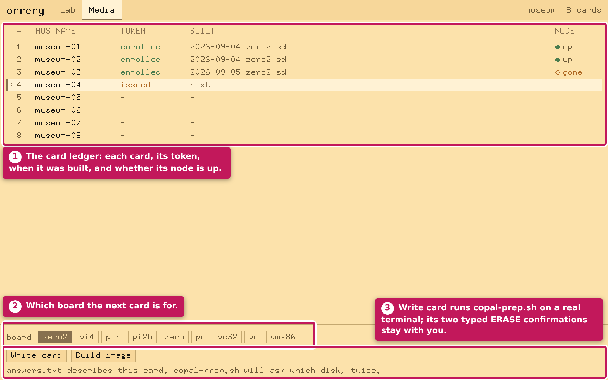

*Picture 15. `--frame-view media --demo`, the museum's eight cards.*

1. The card ledger: each card, its token, when it was built, and whether its node is up.
2. Which board the next card is for.
3. Write card runs `copal-prep.sh` on a real terminal; its two typed `ERASE` confirmations stay with you.

<a id="part-8"></a>
## 8. The verbs

**Why it exists.** Every verb is either a command a person could have typed, or a session aimed at one node. There is no third kind.

**How it fits.** The write verbs go through `copal fleet`, one node at a time, so eight nodes give eight answers. "Six of eight got the memo" is the normal case, and the console must be able to say so. The session verbs use orrery's own SSH, SFTP and RDP clients, with the operator's own certificate.

| Verb | Key | On | What it opens |
| --- | --- | --- | --- |
| **Control** | `c` | one node | the node's desktop, over RDP with mutual TLS |
| **Terminal** | `t` | one node | a shell, in a pane, with no password asked |
| **Exchange** | `e` | one node | a two-pane file browser over SFTP |
| **Send** | `s` | many | one file to every selected node, with a per-node result |
| **Message** | `m` | many | a banner on every selected screen |
| **Run** · **Scene** | `r` · `S` | many | the CLI's own verbs, per node |
| **Snapshot** · **Power** | `k` · `p` | many | as above; `power on` is the supply's job, not ssh's |
| **Observe** | `o` | none | **refused**: a node capturing its screen every few seconds would be a capture daemon on every machine in the museum |

<a id="part-9"></a>
## 9. Underneath: no dependencies, and the wire

**Why it exists.** `copal-build` compiles the checkouts on the node itself, and a fleet node is on a LAN that never reaches the internet. A dependency is a crate fetch that fails on the one machine this is meant to run on.

**How it fits.** So it is all here, in an empty `[dependencies]`: HTTP, JSON, Wayland, AppKit through the Objective-C runtime, a software canvas, two bitmap fonts, SHA-2, X25519, Ed25519, ChaCha20-Poly1305, AES-GCM, SSH-2, SFTP, TLS 1.3, X.509 and RDP. Each protocol was tested against somebody else's implementation: a real `sshd`, OpenSSH's own `sftp-server`, `openssl s_server`, and xrdp. `src/profile.rs` is the one crypto whitelist. `orrery --profile-sshd` prints it as `sshd_config` lines, which `copal-prep.sh` writes onto the node, so the two ends cannot drift. The host key must be a certificate signed by the fleet CA. There is no trust-on-first-use.

The README's figures: 25,700 lines of Rust, an 817 KB stripped release binary, 1.1 MB resident serving the wall (against 22 MB for the Python prototype), and 321 tests (342 on Linux, where the compositor tests run). None of this part is pictured. The wire needs real servers, which the `tools/*-check.sh` scripts start in containers.

<a id="part-10"></a>
## 10. What the pictures found

- **The wall's write verbs cannot succeed from the page.** `assets/wall.html`'s `post()` sends only `content-type`, and `/api/verb` in `src/main.rs` requires `X-Copal-Token` matching `--operator`. So in the operator posture every Scene, Run, Power or Snapshot pressed on the page answers *the operator token does not match* (picture 5). The route itself works with the header (the `curl` in part 3). This guide does not fix it. Ways to fix it include asking for the token once in the page, or having the page send it from a cookie the operator sets.
- **Some sentences are older than the code.** The wall's seat panel still calls Exchange and the live session "L6, not built" (picture 6). The terminal seat's Terminal face explains that a shell "would need a second credential". The README and `docs/console.md` both say the native window now has Terminal and Exchange, over the `fleet-human` principal the operator certificate already carries.

<a id="part-11"></a>
## 11. How it fits together

| Part | What it is | Why it exists | Reads | Can change things? |
| --- | --- | --- | --- | --- |
| `copal fleet state` | the read model, a JSON document | one place the fleet's state lives; no cache, no discovery | the fleet | no |
| The wall (`--listen`) | one HTML page, polled every 5 s | a gallery screen and a phone can open it | `/api/state` | only with `--operator`, and then through the allow-list |
| The seat (`--seat ID`) | one node over RFB, in a terminal | one machine, full screen, without a browser | `copal fleet state`, then that node's screen | Control only, and `Ctrl-]` always lets go |
| The museum interface (`--gui`) | a native window: Lab, Media, panes | the operator's console, on the operator's own machine | `copal fleet state`, `answers.txt`, the card ledger | in the operator posture: the verbs in part 8 |
| `src/verbs.rs` | the allow-list | the security boundary: verb, argument shape, node id | the document just returned | it decides what may run |
| `src/profile.rs` | the crypto whitelist | one list for both ends; `--profile-sshd` prints the node's half | — | — |
| `--frame` · `--demo` | a window without a compositor; a fleet without machines | the drawing can be reviewed anywhere | the fixture | no |

## How these pictures were made

`tools/feature-guide.mjs`, with no dependencies (Node 22 or later, `chromium` and util-linux `script` on `PATH`, ports 8180–8183):

- **Live, in headless Chromium:** pictures 1–6, from two `orrery --demo` consoles (gallery and operator posture), driven over the DevTools protocol.
- **Live, in a real pseudo-terminal:** pictures 7–8. `orrery --seat` runs under `script`; its output is read back through a small terminal emulator and drawn cell by cell. The node is **simulated**: an RFB 3.8 server in the script, found through a stand-in `copal fleet` that prints the fixture with museum-05's address set to 127.0.0.1.
- **Rendered by orrery itself:** pictures 9–15, with `--frame` against the fixture, converted from PPM to PNG and shown at twice size with nearest-neighbour pixels.
- **Not pictured:** the live `--gui` window, which would need the desktop's compositor, and `--profile-sshd`.
