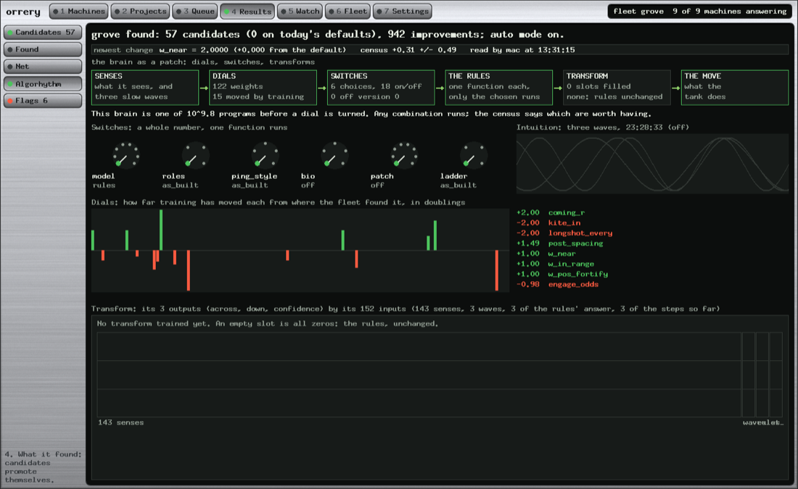

# Algorhythm: Hybrid Programming of Game Agents by Monte Carlo Selection of Interchangeable Functions, Continuous Weights and Confidence-Gated Learned Transforms

*Paul Richeson · Lab Report — IEEE Format · 30 October 2026*

Copyright (c) 2026 Paul Richeson. MIT licensed, as orrery.

Companions: treadcore `bio.rs`, `patch.rs`, `weights.rs`, `commander.rs`; orrery `tools/plans/treadcore.py`,
`tools/fleet-versions.py`, `src/training.rs`; `docs/brain-versions-lab-report.md`, `docs/brains.md`.

---

## Abstract

We describe Algorhythm, a design for game agents in which a person writes many interchangeable
functions for each decision, and a population of Monte Carlo simulations chooses among them. Control flows through
three layers, drawn by analogy with a frequency-modulation modular synthesizer: continuous weights act as analogue
dials, whole-number enumerations act as rotary switches selecting exactly one function, and a final learned
transform, which reads the agent's senses and the deterministic function's own answer, may override that answer when
it is confident. The transform may be several steps, and at all zeros it leaves the rules unchanged. We report the
design's evolution on a working fleet of nine machines, its implementation in the tank game treadcore, a new
five-way pinging function as a worked example of A/B/C/D/E selection, and a biorhythm input. All of the new layers are
silent by default, verified by identical results on nine scenario families. We have not yet trained a transform or
measured the new choices over a full census, and we report those as open. The closest prior work we found is
Programming by Optimization and residual policy learning. We found no system combining all of these in this form,
and our search was not exhaustive.

**Index Terms:** algorithm configuration, game AI, hybrid intelligence, Monte Carlo evaluation, programming by
optimization, residual learning, sequential testing.

---

## I. Introduction

Writing game AI usually forces a choice. Hand-written rules are legible and start out competent, but they stop
improving when their author does. A learned network can improve without limit, but starts at nothing. In this fleet
the difference is stark: the hand-written brain beats every learned model we have by about twenty points a seat.

Paul Richeson's proposal is to stop choosing, and to think of a program as a synthesizer. *"Analogue dials (weights)
... used for between the provided functions. Some functions are like a switch dial on a synth making 0-7 of the sounds
of that dial."* The author supplies many of each component. Generally any combination should run, some work better
than others, and as with FM sounds, certain patches make the sum greater than the whole. A Monte Carlo of simulated
games is the ear that decides.

## II. Prior Work

**Programming by Optimization.** The nearest work we found is Hoos's Programming by Optimization [1]. Its central idea
is the one here: treat a program as a large space of programs, avoid committing prematurely to design choices, and let
an optimization procedure choose. That work targets algorithm design generally, usually for runtime or solution
quality on problem instances, rather than agents in an adversarial game.

**Algorithm selection and configuration.** Rice posed choosing an algorithm for a problem as a formal question in 1976
[2]. SMAC [3] extended automated configuration from few numerical parameters to many categorical ones, the same mix of
dials and switches used here. Our search does not use SMAC's models; it uses a fit for dials and exhaustive A/B for
switches.

**Residual learning.** Silver et al. [4] and Johannink et al. [5] improve a hand-designed controller by learning a
correction added to its output, rather than learning from nothing. Our transform stage is this idea, with two
additions: a confidence gate, and several steps.

**Programmatic policies.** Verma et al. [6] go in the opposite direction, searching for a program that imitates a
trained network. It shares the belief that programs and networks should be combined.

**Sequential testing in engines.** Chess engines proved the methodology of testing every change on many games:
Stockfish's Fishtest runs SPRT over distributed volunteers' machines [7]. Our sequential read and held-out reads are
from that tradition. Population Based Training [8] jointly optimizes models and hyperparameters in a population, and is
the nearest learned counterpart to a fleet.

**Synthesis.** Chowning's FM synthesis [9] gives the analogy its vocabulary. Horner et al. [10] used genetic algorithms
to find FM parameters, a direct precedent for searching a synthesizer's patch space by simulation. This name also comes
from there: the arrangements of operators on FM instruments are called algorithms.

**What we believe is different.** Not any one layer. It is the whole arrangement: a person writing many interchangeable
functions, whole-number selection under a game's Monte Carlo, continuous dials over them, and a learned override that
reads the rules' own answer. We call this novel with caution: the search here was brief, and the parts have a long
history. A proper literature review would be needed before any such claim in a real publication.

**Is there a name?** We found no single established name for the exact combination. The closest for the core idea is
Programming by Optimization [1]. Hyper-heuristics select among low-level heuristics [13], and neural architecture search
chooses among operations, though DARTS relaxes that choice into a blend during search [14], which ours never does. We call
the method *patch programming* and the system Algorhythm. Both are proposals; we did not search whether they are in use.

**The claim, stated precisely.** Choosing among implementations by optimization is not itself new. What we did not find is
the combination: many hand-written implementations of each decision, whole-number switches and continuous dials optimized
together, selection by paired Monte Carlo games, and a learned stage that overrides the rules' answer only when confident.

## III. Evolution to This Phase

1. **Fixed rules.** A hand-written Commander.
2. **Dials.** About 120 numbers it scales by, tuned by a fit over censuses: a census being one team on trial settings
   against the rest, on paired seeds. Promotion by held-out reads, then scenario families.
3. **Switches.** 18 on/off capabilities.
4. **Enumerations.** `ladder`, `roles` and `model`, each a whole number choosing a version.
5. **A learned league.** Nets in seven slots, and a separate GPU population, crucible.
6. **The verification of 30 October** (`docs/brain-versions-lab-report.md`). No switch could be promoted, owing to two
   faults; mended, pings off became the first, at +1.99 a seat.
7. **Algorhythm,** this paper: functions treated as a patch, with the learned stage placed *after* the rules rather
   than instead of them.

## IV. The Design

### A. The signal path

```text
senses + waves ─► DIALS ─► SWITCHES ─► THE RULES ─► TRANSFORM (steps) ─► THE MOVE
  143 + 3         122       6 + 18     one function   confidence-gated
```

**Dials** (weights) are continuous: `ping_warn_reach`, `engage_odds`. **Switches** are whole numbers:
`Settings::choice` rounds and clamps, and each site is one `match`, so exactly one function runs. **The rules** are
deterministic: the same seed plays the same game, so two settings are compared on the same seeds. **The transform**
may then move the answer.

### B. How the variables compound

Three kinds of compounding are at work, and they differ in cost.

**Multiplicative choice.** Each switch multiplies the programs available. Today's brain has 6 choices (8, 4, 5, 5, 8 and
4 versions) and 18 on/off capabilities: 25,600 x 2^18, about 10^9.8 programs before a dial is turned. **This cannot be
searched exhaustively, and it is not.** Each version is read against today's defaults, one at a time.

**Dials that mean different things by position.** A dial scales the function a switch chose. `ping_warn_flee` does
nothing unless `ping_style` carries warnings. That is the synthesizer's behaviour: a filter knob is silent if nothing
is routed through it. It also has a cost in this method: a dial that does nothing reads as an exact zero, which is
indistinguishable from noise to a fit unless flagged. The fleet now flags exact-zero reads.

**Interactions found by promotion.** A promoted version becomes the baseline, so the next read is conditional on it. A
pair that helps only together is invisible to one-at-a-time reads, unless one of the pair happens to get promoted. This
is the method's largest blind spot, and precisely what the FM analogy says matters most: *some patches are greater than
the sum.* Wide trials and the transform are partial answers. Explicitly testing pairs of switches is a natural next step.

### C. A/B/C/D/E: pings as a worked example

`ping_style` is a five-way rotary switch over how a team communicates. What Paul asked for, each in the functions, is
below. Pings were a single undifferentiated "come here"; now each carries a kind: help, caution, info, warning or
defend.

| Position | Name | Calls | Comes when | Expect it to work when |
|---|---|---|---|---|
| A (0) | `as_built` | the switch `pings` decides; all are help | as built | the baseline: the rules as they stand |
| B (1) | `help` | outnumbered only | a help call within `ping_help_reach` | calls are rare and mean something, unlike the old pings |
| C (2) | `warn` | warnings and cautions, nobody is summoned | a warning moves a tank `ping_warn_flee` away; a caution drops a nearby rally | the army is better spread than massed |
| D (3) | `defend` | only a base under attack | a defence within `ping_defend_reach`, held `ping_defend_hold` times as long | bases decide games |
| E (4) | `all` | whatever it saw: defend, help, warn, caution, info | by each kind | the team uses more information than it loses in chatter |

**Each may lose, and that is fine.** The earlier read showed that a team with no pings beats one where every ping is a
summons. That might mean communication has no value here, or that this one kind of it was bad: **`help` is the test of
the second.** The dials stay in play: if `help` wins at a reach of 60, the fit can find whether 40 is better.

**Combinations that do not work** are expected. `warn` with a large `ping_warn_flee` may scatter a team; `all` with
`roles = three_guards` may leave no one to answer. They run, they read badly, and they are not promoted.

**A person is always answered.** Whatever the bots do among themselves, a human's ping now works, with the kind the
person gives it. Previously, promoting pings off made bots ignore people. A census has no people in it, so this cannot
change a census.

### D. Intuition: a biorhythm sense

`bio` is a switch over wave shape: off, sine, triangle, square or saw. Three waves run in the ratio 23:28:33, each seat at
its own phase, set in time by `bio_period`, and they swing `engage_odds` by `bio_amount`; the same waves are inputs to the
transform.

**A note on the name.** Biorhythm *theory* as a claim about people has been reviewed and found unsupported [11], [12].
Nothing here depends on that theory. To a tank this is an LFO: a slow, deterministic oscillator from the synthesizer's
own kit, varying how bold each tank is over time. It might help by keeping a team's tanks from all making the same choice
at once. The census will say, and it may well say no.

### E. The transform, and multi-step

Each Move the rules decide passes through, if `patch` chooses a slot:

```text
x    = senses (143) ; waves (3) ; the rules' answer (direction 2, distance 1)
y[0] = 0
y[k+1] = y[k] + tanh( A[k] [x ; y[k]] + b[k] )
if y[n].confidence >= patch_confidence:  move += (y[n].across, y[n].down) * patch_reach
```

**Multi-step** means each step reads the steps before: one may propose and the next correct, a chain rather than one
matrix, much as operators in FM feed each other. **At all zeros, nothing changes,** which is the property taken from
residual learning [4], [5]: training starts where the rules are. And it is a **gate, not a blend:** the transform stays
silent until confident, which is "up to the AI net to override if its confident".

**Only the chosen one runs.** At `patch = 0` no senses are read for it and no time is spent. The same goes for each
ping style and each wave.

**What reads what.** The learned nets in `model` replace the rules entirely, and every slot loses by about 20 a seat. The
transform inherits the rules' strength. We expect that to matter, and it is not yet shown.

### F. The inspector

The Results chapter gains an **Algorhythm** page, drawn from the brain's own `weights.rs`, so it cannot describe a
different brain: the signal path, left to right; each switch as a rotary with its position lit; the waves, plotted; each
dial's movement from before the fleet's first promotion, in doublings; and each transform as a block of 3 outputs by 152
inputs, with bands marking senses, waves, the rules' answer and the steps so far. A step is the "64 by something" block:
it reads like the net's layers, and it is laid out with the same colours. The Net page's matrices are also larger.



*Fig. 1. The real brain as of this paper: all switches at version 0 and no transform trained.*

## V. Implementation

| Part | Where | State |
|---|---|---|
| `PingKind` carried by the sim, old clients' pings being help | treadcore-sim | built, tested |
| `ping_style` and seven dials; what each kind does | `commander.rs` | built, tested |
| A person is always answered | `commander.rs` | built, tested |
| `bio`, three waves | `bio.rs` | built, tested |
| Multi-step transform, gate, slots from `CENSUS_PATCHES` | `patch.rs` | built, tested; **no slot filled** |
| Exact-zero flag; a patch asked for only when trained | `treadcore.py` | built |
| Inspector, version tracker | `training.rs`, `fleet-versions.py` | built |
| **Training a transform** | | **not built** |
| **Fleet reads of the new choices** | | **not run: all tasks are stopped** |
| crucible reading treadcore's senses | | **not built:** its arena, senses and net differ |

Training is the largest missing piece. `Patch::flat` and `with_flat` give a search one list of numbers. crucible cannot
train it yet, because crucible's arena has its own senses and net; the likely first trainer is therefore an evolution
strategy over censuses on the fleet, as `spsa` and `tune` already move weights, at the cost of many games a step.

## VI. Results

**The current brains are intact.** With all new layers at their defaults, the nine scenario families read exactly as
before the change, number for number (319/400, 400/400, 326/400, 400/400, 998/1000, 993/1000, 1000/1000, 997/1000,
812/1000). All treadcore tests pass, with 12 new ones in the brain: each kind does what it says; a style hears only what it carries; a
person is answered; a zero patch changes nothing; an unconfident patch changes nothing and a confident one does; a later
step reads an earlier one.

**The new switches are alive.** A smoke test on one Mac, 9 seeds, 900-second games on three maps, against the defaults:

| Trial | Every map | By map |
|---|---|---|
| `ping_style = all` | +2.16 ±2.29 | industry −2.03 ±2.99, island −0.93 ±1.92, naval **+9.43 ±3.19** |
| `bio = sine` | −0.69 ±1.02 | industry +0.90, island +0.07, naval −3.03 |
| `bio = sine`, `bio_amount = 0.8` | +0.24 ±0.65 | industry +0.28, island −0.35, naval +0.79 |
| `engage_odds = 0.9`, for scale | −1.29 ±1.40 | industry +2.52, island −0.58, naval −5.81 |

These show that games change, and no more: the fleet's own first read is 55 seeds, and its bar is two held-out reads of 400.
The naval figure is three seeds. It is worth reading properly, not worth believing yet.

**A trap we fell into.** A first smoke test used 300-second games on one map, and even `engage_odds` read exactly zero: in
five minutes those tanks barely fight. A switch must be judged by full-length games, and an exact zero on a short test
means little.

**Nothing here is a measurement of strength yet.** We do not know that typed pings, intuition or a transform are better
than what they extend.

## VII. Discussion

**Limitations.** One-at-a-time reads miss the interactions the analogy prizes most. A 10^9.8 space is sampled very
sparsely. A census of bots cannot value what a person wants, as pings showed. Every switch position costs seeds, and most
positions so far have read as nothing. And the transform is exposed to overfitting a score, where a person's idea of good
play may be different.

**Future work.** Train a first transform; read `ping_style` and `bio` on the fleet; find why `ladder = hunt_first` plays
identical games; test pairs of switches; per-seat or per-role patches, so that each tank in a team truly takes its own path
through the code; rewritten functions such as `target_pick`; connect crucible.

## VIII. Conclusion

Algorhythm treats a game agent as a patch: many functions by hand, dials and switches set by simulation, a learned stage
that may override when it is sure. The structure is in place and proven silent. What it can actually achieve remains to
be measured.

## Acknowledgment

The design, the synthesizer analogy and the requirements are Paul Richeson's. Implementation and drafting by Claude.

## References

[1] H. H. Hoos, "Programming by optimization," *Commun. ACM*, vol. 55, no. 2, pp. 70–80, Feb. 2012. https://www.cs.ubc.ca/~hoos/PbO/Literature/Hoos12.bib

[2] J. R. Rice, "The algorithm selection problem," *Advances in Computers*, vol. 15, Academic Press, 1976. https://docs.lib.purdue.edu/cstech/68

[3] F. Hutter, H. H. Hoos and K. Leyton-Brown, "Sequential model-based optimization for general algorithm configuration," in *Proc. LION*, Springer, 2011, pp. 507–523. https://www.springerprofessional.de/en/sequential-model-based-optimization-for-general-algorithm-config/3787338

[4] T. Silver et al., "Residual policy learning," arXiv:1812.06298, 2018. https://arxiv.org/abs/1812.06298

[5] T. Johannink et al., "Residual reinforcement learning for robot control," arXiv:1812.03201, 2018. https://arxiv.org/abs/1812.03201

[6] A. Verma et al., "Programmatically interpretable reinforcement learning," in *Proc. ICML*, PMLR 80:5045–5054, 2018. https://arxiv.org/abs/1804.02477

[7] "Fishtest FAQ," official-stockfish. https://github.com/official-stockfish/fishtest/wiki/Fishtest-faq ; "Sequential Probability Ratio Test," Chessprogramming wiki. https://chessprogramming.org/Sequential_Probability_Ratio_Test

[8] M. Jaderberg et al., "Population based training of neural networks," arXiv:1711.09846, 2017. https://arxiv.org/abs/1711.09846

[9] J. Chowning, "The synthesis of complex audio spectra by means of frequency modulation," *J. Audio Eng. Soc.*, vol. 21, no. 7, pp. 526–534, 1973. https://ccrma.stanford.edu/papers/synthesis-of-complex-audio-spectra-means-of-frequency-modulation

[10] A. Horner, J. Beauchamp and L. Haken, "Machine tongues XVI: Genetic algorithms and their application to FM matching synthesis," *Computer Music J.*, vol. 17, no. 4, 1993. https://labs.sonicfield.org/library/machine-tongues-xvi-genetic-algorithms-and-their-application-to-fm-matching-synt

[11] "Biorhythm (pseudoscience)," Wikipedia. https://en.wikipedia.org/wiki/Biorhythm_(pseudoscience)

[12] T. Hines, review of biorhythm studies, as described in [11]; the original was not read for this paper.

[13] E. K. Burke et al., "Hyper-heuristics: a survey of the state of the art," 2013. https://eprints.nottingham.ac.uk/28281/

[14] H. Liu, K. Simonyan and Y. Yang, "DARTS: Differentiable architecture search," *ICLR*, 2019. https://arxiv.org/abs/1806.09055
