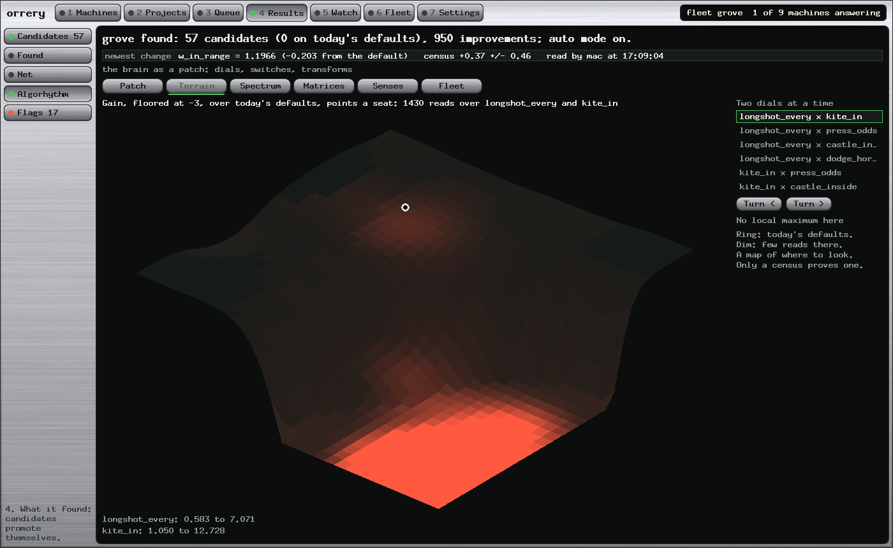
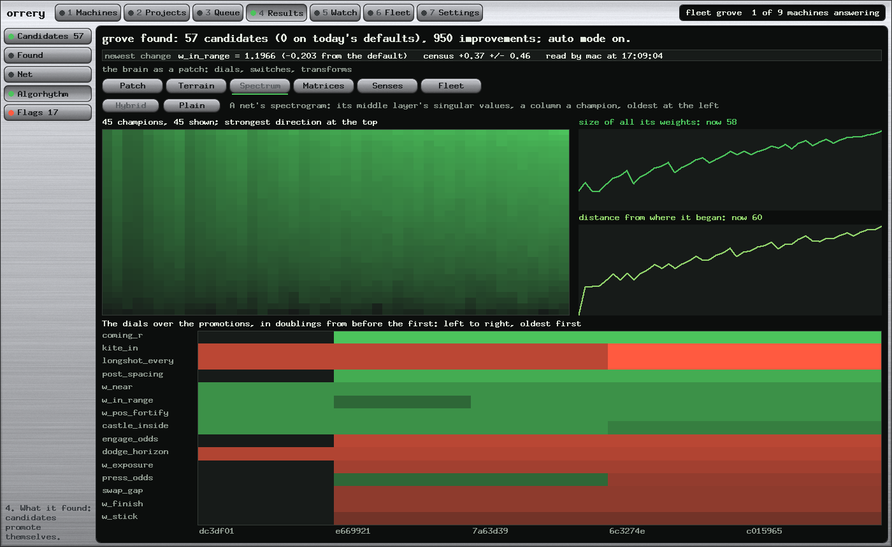
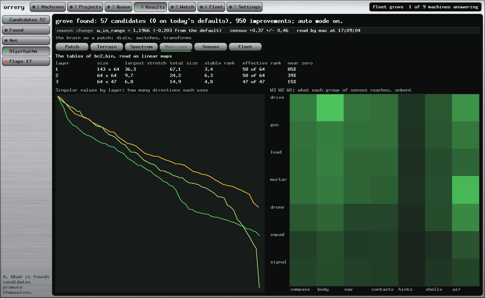
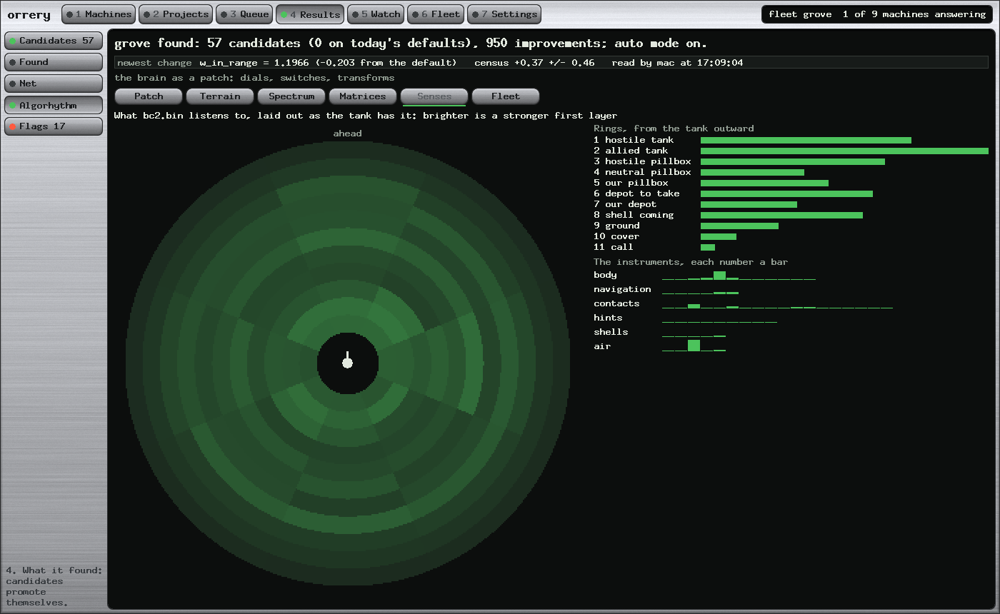
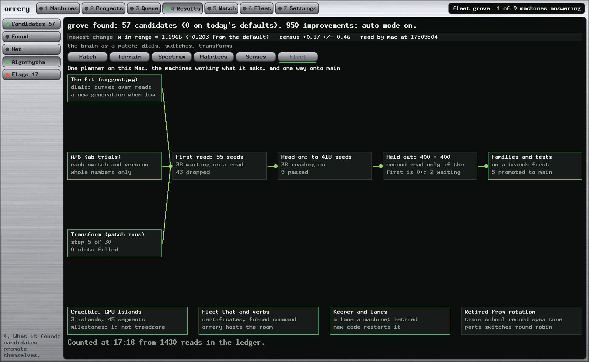

# Reading a Growing Game Brain: Terrain, Spectrum, Matrix and Sensor Views of a Fleet's Search

*Paul Richeson · Lab Report — IEEE Format · 30 October 2026*

Copyright (c) 2026 Paul Richeson. MIT licensed, as orrery.

Companions: orrery `tools/analysis.py`, `src/analysis.rs`, `tools/plans/treadcore-view.py`;
`docs/algorhythm-lab-report.md`, `docs/brain-versions-lab-report.md`.

---

## Abstract

We add five analysis views to the console that runs a fleet's search over a tank game's brain: a fitness terrain
estimated from past census reads, a spectrogram of network weights across champions, a singular-value reading of each
weight matrix and of their product, a sensor map drawn as the tank's own compass, and a diagram of the fleet's
orchestration. All are computed from existing records, with no new games and no added dependencies. From 1430 reads, six
dial pairs show no local maximum above today's defaults; one interior maximum appears, at -0.183. This does not show
that none exists, because the estimator shrinks heights and rests on an additive correction we did not validate. The
shipped first-layer matrix has 85% of its entries near zero and a stable rank of 3.4 against an effective rank of 58.
Across 1091 plain champions the weight norm grew from 118 to 563, and we do not show that this growth produced skill.
These views suggest where to look. Only a census proves a change.

**Index Terms:** fitness landscape analysis, kernel regression, neural network visualization, singular value
decomposition, simulation-based search, visual analytics.

---

## I. Introduction

The fleet evaluates a candidate by a census: paired games against the current defaults, on shared seeds, giving a gain
in points a seat and its standard error. Candidates that survive a sequential read, a held-out read and a families gate
are promoted. That machinery answers one question well: is this candidate better? It says little about the shape of
what is being searched, or what a net has become after a thousand champions.

The operator asked for that view: "I want a 3d local maxima," "something like a spectrogram," "analysis of the matrix
tables, and their transform," and the input sensors "as it would be seen by the inputs." This report describes how those
views are computed, what they showed on the first reading, and how far each can be trusted.

## II. Prior Work

Fitness landscape analysis treats a search space as a surface and characterizes it. Pitzer and Affenzeller [1] and
Malan [2] survey the field. Local Optima Networks [3] compress a landscape to its optima and the moves between them, and
Search Trajectory Networks have been applied to neuroevolution [4]. Li et al. [5] plot two-dimensional loss surfaces
along random directions, using filter normalization so that plots of different nets can be compared. Martin and Mahoney
[6], [7] read the singular values of weight matrices through training, and describe phases of implicit
self-regularization. Zeiler and Fergus [8] map what a vision network attends to by occluding parts of its input.

We borrow a form from each, and three differences matter. Our terrain is estimated from reads the search had already
made, not from a designed grid. Our fitness is a noisy game result, not a differentiable loss. And our sensor view shows
weight magnitudes, not the occlusion test of [8]: it says what the first layer could hear, not what changes the tank's
behaviour. "Spectrogram" is our analogy: time runs across, as in the audio form, but the vertical axis is singular-value
rank, not frequency.

## III. Method

### A. The fitness terrain

Each usable ledger row, with at least 12 seeds and a baseline at the plain defaults, gives a dial vector and a gain. The five
dials most often moved give six of their pairs. Each dial is measured in doublings from today's value, x = log2(v / v0),
limited to ±2.5. The surface on a 30 by 30 grid is a Gaussian-kernel average with an added constant in the denominator:

    z(x, y) = sum(k_i w_i d_i) / (sum(k_i w_i) + 2)

Here d_i is the read's gain, w_i = 1 / (s_i^2 + 0.25) is its precision weight, and k_i is the Gaussian kernel at
bandwidth one tenth of the wider axis, and no less than 0.15 doublings. The constant 2 pulls thinly supported ground toward zero, so one lucky read
cannot raise a hill. A local maximum is an interior grid point at least as high as its eight neighbours, with support of
2 or more.

Reads were taken against whatever the defaults were that day. To bring them to one baseline, we subtract the held-out
gains of every promotion since: d_i = raw d_i minus the sum of g_p. This assumes that gains add and that held-out gains
are unbiased. Neither has been tested here.

The surface is drawn by the painter's algorithm: isometric, back to front, in filled triangles, with quarter-point
terraces in place of contour lines. Height and colour are floored at -3, because valleys near -7 otherwise flatten the
ground near today. Colour fades where support is thin. The floor is a drawing choice, and the page says so.

### B. The weight spectrogram

For each champion file, up to 48 evenly spaced in time, we take the singular values of the 32 by 32 middle layer by Jacobi rotation in pure Python.
Each champion becomes a column, strongest direction at the top. Beside it we plot two lines over the whole net: the
norm |w_t| and the drift from the first champion |w_t - w_0|. A second heat map shows each promoted dial over
the promotions, in doublings from its first value.

### C. Matrix tables and their transform

For each layer W of the shipped net `bc2.bin` we report the largest singular value s1, the Frobenius norm,
the stable rank (Frobenius / s1)^2, the effective rank (the count of singular values above 0.01 s1), and the share of
entries under 1% of the largest entry. The product W3 W2 W1 gives a linear map from senses to outputs, reduced to a
grid of input groups by outputs. It ignores the activations, so it says what could reach an output if nothing bent.

### D. The senses and the fleet

The first 88 inputs are 8 compass sectors by 11 channels. We draw these as a disc with the tank's forward at the top and a ring per channel, each cell lit by the norm of its first-layer weights. The remaining inputs are drawn as
instruments, one bar per number. The Fleet tab draws the road from trial sources to main as boxes and arrows, with live
counts from the queue.

## IV. Results

Readings were taken on 30 October 2026 at 17:18, while only one machine could be reached, so the counts are a snapshot.

### A. Terrain

*Fig. 1. Gain over today's defaults, floored at -3, from 1430 reads. Today's defaults stand at the ring. The bright corner is the floor, not a summit: red is loss.*

Across all six pairs the height never exceeded +0.062, and five pairs have no interior local maximum. The sixth,
`kite_in` by `castle_inside`, has one, at -0.183 with support 78, near `kite_in` 1.92 and `castle_inside` 9.23. Lowering
`longshot_every` and `kite_in` together costs up to about 6.7 points a seat, so the search's movement along that
direction looks well founded.

The tempting reading is that today's defaults sit at a local summit, and these data cannot carry it. Shrinkage and
smoothing lower true peaks. The promotion correction can push older reads downward by construction. A slice through two dials
averages over all the others. And the reads cluster where the search chose to go.

### B. Growth

*Fig. 2. Hybrid champions: singular values by champion, weight norm, drift from the first, and the promoted dials below.*

**Table I. Growth across champions.**

| | Plain | Hybrid |
|---|---:|---:|
| Champions | 1091 | 45 |
| Norm, first to last | 118.2 to 563.1 | 14.3 to 58.3 |
| Drift from first | 543.2 | 59.7 |
| Cosine, first to last | 0.27 | 0.02 |
| Middle layer largest singular value, last | 127.0 | 14.2 |
| Middle layer smallest singular value, last | 1.44 | 0.14 |

The cosine is computed from the norms and drift by the law of cosines. In both lineages the norm grew about fourfold,
and the first and last nets are nearly unrelated in direction, the hybrid's almost orthogonal. Fig. 2 shows the whole
spectrum brightening together as the norm rises. Growth in scale alone could produce this, and it need not mean added
capacity. We have not compared norm with strength, nor have we normalized for scale, as [5] does when comparing nets.

### C. The matrices

*Fig. 3. Singular values by layer, and the end-to-end map from groups of senses to outputs.*

**Table II. The layers of `bc2.bin`.**

| Layer | Size | Largest | Frobenius | Stable rank | Effective rank | Near zero |
|---|---|---:|---:|---:|---:|---:|
| 1 | 143 × 64 | 36.3 | 67.1 | 3.4 | 58 of 64 | 85% |
| 2 | 64 × 64 | 9.7 | 24.2 | 6.3 | 58 of 64 | 39% |
| 3 | 64 × 47 | 6.8 | 14.9 | 4.8 | 47 of 47 | 15% |

The gap between stable and effective rank says each layer has a few strong directions and many weak but non-zero ones.
Layers 1 and 2 each have six directions under the 1% line; layer 3 uses all 47. This is a description of the
matrix. It does not show that the weak directions are unused in play, and it does not identify any part as safe to prune.

### D. The senses

*Fig. 4. First-layer weight by sense, as the tank has it: forward at the top, a ring per channel, instruments at the right.*

**Table III. Mean first-layer weight norm by input group.**

| Group | Mean norm | | Group | Mean norm |
|---|---:|---|---|---:|
| Air | 8.36 | | Contacts | 2.90 |
| Body | 5.68 | | Shells | 2.20 |
| Compass | 3.60 | | Hints | 0.38 |
| Navigation | 3.57 | | | |

The hint inputs are the faintest group by an order of magnitude, and no input is fully silent. Weight magnitude depends
on input scale, so an input with large values can matter with small weights. An occlusion test in the manner of [8],
blanking each group and running a census, would measure this directly, and we have not run it.

### E. The fleet

*Fig. 5. How the new fleet orchestrates: three sources of trials, one road to main, and the machinery around it.*

At this reading the road held 38 candidates waiting on a first read and 38 reading on, with 43 dropped, 9 passed, 2 waiting on a
held-out read, and 5 promoted. The transform trainer was at step 5 of 30, with no slot yet filled.

## V. Limits

- **Terrain.** The correction, the shrinkage and the sampling bias listed above all affect heights. Absence of a peak is
  weak evidence, and any peak needs a census.
- **Numerical care.** Our first routine stopped Jacobi after five sweeps and returned too many values for rectangular layers, reading rank 48 from 47 outputs. It now works on the smaller Gram matrix, to convergence, and returns known answers on small test matrices. Values near 1e-6 of the largest would still be unreliable, since squaring loses precision.
- **Linear readings.** Singular values and the end-to-end map ignore activations and the distribution of real inputs.
- **Comparing lineages.** Plain and hybrid nets differ in shape, input and age, so Table I describes each and does not rank them.
- **A snapshot.** One brain, one moment, one thinned fleet. We did not measure how these numbers vary between runs.

## VI. Conclusion

A fleet's records hold more than its verdicts. For no added games, the console now shows the terrain around today's
dials, how the nets have grown, what each matrix does, and what the first layer hears. The first reading suggests three
follow-ups: run a census at the one interior maximum, test whether norm growth tracks strength, and run an occlusion
census of the sensor groups, starting with the hints. Each is a question these views raised and only games can answer.

## Acknowledgment

Paul Richeson directed this work and chose the views. Claude (Anthropic) wrote the code and drafted this report.

## References

[1] E. Pitzer and M. Affenzeller, "A comprehensive survey on fitness landscape analysis," in *Recent Advances in Intelligent Engineering Systems*. Springer, 2012.

[2] K. M. Malan, "A survey of advances in landscape analysis for optimisation," *Algorithms*, vol. 14, no. 2, 2021.

[3] G. Ochoa, S. Verel, F. Daolio, and M. Tomassini, "Local optima networks: A new model of combinatorial fitness landscapes," in *Recent Advances in the Theory and Application of Fitness Landscapes*. Springer, 2014.

[4] L. Sarti and G. Ochoa, "A NEAT visualisation of neuroevolution trajectories," in *Applications of Evolutionary Computation*. Springer, 2021.

[5] H. Li, Z. Xu, G. Taylor, C. Studer, and T. Goldstein, "Visualizing the loss landscape of neural nets," in *Advances in Neural Information Processing Systems*, 2018. arXiv:1712.09913.

[6] C. H. Martin and M. W. Mahoney, "Implicit self-regularization in deep neural networks: Evidence from random matrix theory and implications for learning," *J. Mach. Learn. Res.*, vol. 22, 2021. arXiv:1810.01075.

[7] C. H. Martin and M. W. Mahoney, "Traditional and heavy-tailed self regularization in neural network models," in *Proc. Int. Conf. Machine Learning*, 2019. arXiv:1901.08276.

[8] M. D. Zeiler and R. Fergus, "Visualizing and understanding convolutional networks," in *Proc. European Conf. Computer Vision*, 2014. arXiv:1311.2901.
