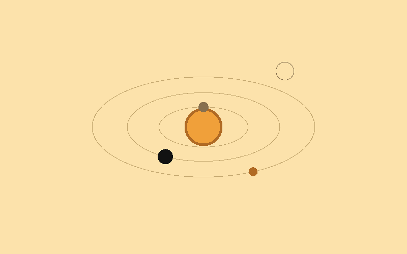

# From Cargo to a Mac Application: a Rust Program with an AppKit Window and No Crates

*Lab Report — IEEE Format · 28 October 2026*

Copyright (c) 2026 Paul Richeson. MIT licensed, as orrery.

Companions:
- `docs/appkit-example/`, the working example this report teaches: `orbit`,
  602 lines, its full source in Appendix A;
- orrery's `src/surface.rs`, `src/mac.rs` and `src/main.rs` (`gui_loop`), the
  same structure at full size;
- `tools/mac-app.sh`, `tools/mem-guard.sh`, and `docs/mac-app-lab-report.md`
  (the bundles and their signatures).

---

## Abstract

orrery is a fleet console written in Rust with an empty `[dependencies]`
table. On a Mac it opens a native AppKit window. It runs from Finder,
Launchpad and the Dock as `Orrery.app`, with an icon and an ad-hoc signature.

This report teaches how that is done, from `cargo new` to the application,
through a small working example, **orbit**. orbit is an animated orrery in
a window that answers the pointer and the keyboard, can draw a frame to a
file, and becomes `Orbit.app`. It is 602 lines and has no crates.

The architecture has four layers:
- **The drawing** writes pixels into a plain buffer and knows nothing of
  windows.
- **A `Surface` trait** is the seam: it hands over a buffer, takes it back
  to show, and says what the person did.
- **An AppKit back end** satisfies the trait using only message sends to
  the Objective-C runtime. No Objective-C class is ever defined, because
  AppKit never has to call into Rust.
- **The program's own loop** polls, draws, presents and sleeps.

Then a script wraps the binary in a signed `.app` bundle.

Measured on an M1:
- orbit builds in 4.2 s (peak 197 MB) to a 320 KB binary and an 816 KB
  bundle;
- its window holds a flat 284 MB, most of it AppKit's shared pages.

The one error that matters was found the hard way the same day. The
program's loop must push and pop an **autorelease pool** around every turn,
because AppKit's own run loop, which would do it, is not running.
- Without the pools, orbit grows 150 MB a second and orrery grew 90 MB a
  second (504 MB to 2,292 MB in 20 s), until the Mac ran out of memory.
- With them, both are flat.

---

## I. Objective

Paul's prompt:

> write a lab report about making orrery a mackit GUI. describe the
> procedure of Rust aplication from cargo to mak kit gui with application
> launcher. give sample code, enough to start an example project from this
> lab report. Teach sections and give working structure and architcture.
> lab report IEEE.

1. Explain how a Rust program gets an AppKit window, and why orrery does it
   the way it does.
2. Give a structure and a working example that a new project can start from.
3. Carry it to an application: a bundle, an icon, a signature and a
   launcher.
4. Record what was measured, and the faults met on the way.

## II. Materials

| Item | Detail |
| --- | --- |
| Machine | iMac, Apple M1 (arm64), 16 GB, macOS 26.6.2 |
| Toolchain | rustc 1.93.1, cargo 1.93.1; Apple's Command Line Tools (`/Library/Developer/CommandLineTools`): the linker, the SDK's frameworks, `codesign`. Xcode itself is not needed |
| Frameworks used | AppKit, Foundation, CoreGraphics, and libobjc (the Objective-C runtime), all part of macOS |
| macOS tools | `sips`, `iconutil`, `PlistBuddy` (the icon), `codesign`, `spctl` (the signature), `open` |
| The example | `docs/appkit-example/` (orbit) |
| The full-size case | orrery: `src/mac.rs` 795 lines, `src/surface.rs` 328, beside the Wayland back end `src/wl.rs` 1,648 |

---

## III. Background: what each part is

This section teaches the pieces in the order a program meets them.

### A. What a Mac application is

A Mac program that shows a window is an ordinary process with three
connections to the system:

1. **`NSApplication`**, the one-per-process object that registers the
   process with the window server, owns the event queue and decides whether
   the process has a Dock icon (its *activation policy*).
2. **`NSWindow`** objects, each a rectangle the window server composites,
   with a *content view* that fills it.
3. **An event loop.** Normally `[NSApp run]`, which never returns: it takes
   events off the queue, hands each to `sendEvent:`, calls your code back,
   and drains an autorelease pool every turn.

orrery and orbit keep the first two and replace the third with their own
loop (§III-E).

A `.app` bundle (§III-G) is how Finder and the Dock know the process as an
application. The window itself does not need the bundle: run from a
terminal, the same binary opens the same window.

### B. Calling AppKit from Rust: the Objective-C runtime

AppKit is written in Objective-C. Every method call in Objective-C,
`[window setTitle:@"orbit"]`, compiles to a C call:

```c
objc_msgSend(window, sel_registerName("setTitle:"), title);
```

So Rust needs three functions from `libobjc`:
- `objc_getClass("NSWindow")` gives a class, which is itself an object;
- `sel_registerName("setTitle:")` gives a selector, a method's name;
- `objc_msgSend(receiver, selector, args...)` sends the message.

**`objc_msgSend` must be called through the exact signature of each
message.** Its header declares it variadic, but it is a trampoline that
jumps to the method with the registers as they are. Calling it as a C
variadic function puts floating-point and struct arguments in the wrong
places. So it is declared with no arguments and cast, at each call, to
the real signature:

```rust
extern "C" { fn objc_msgSend(); }

unsafe fn send1<A, R>(o: Id, s: Sel, a: A) -> R {
    let f: unsafe extern "C" fn(Id, Sel, A) -> R =
        std::mem::transmute(objc_msgSend as unsafe extern "C" fn());
    f(o, s, a)
}
```

One such helper per argument count (`send`, `send1`, `send2`, `send4`)
covers every message the program sends.

On **arm64** this one entry point is correct even for messages that return
structs: an `NSRect` (four `f64`) comes back in registers `v0` to `v3`. On
**Intel** a struct larger than 16 bytes is returned through memory, by
`objc_msgSend_stret`. orbit and orrery are built and tested on Apple
silicon only; an Intel build would need that second entry point for
`frame`.

### C. Why no crates, and what the crates would give

orrery's rule is an empty `[dependencies]` table. Its software must build
on a node with no network, so a crate fetch is a failure. The frameworks
are on every Mac, so declaring the dozen functions used is not a
dependency. The usual alternatives, for a project without that rule:

| Approach | What it gives | What it costs |
| --- | --- | --- |
| **Message sends by hand** (this report) | nothing fetched; every call visible; about 300 lines for a window | `unsafe` throughout; you own the details below (pools, struct returns, coordinates) |
| `objc2` with `objc2-app-kit` | typed bindings for all of AppKit, memory management by the type system | a large dependency tree |
| `winit` and `softbuffer` | a window and a pixel buffer on Mac, Windows, Linux | the event loop is winit's (a callback), several dozen crates |
| `objc_allocateClassPair` and `class_addMethod` | your own `NSView` subclass with `drawRect:`, delegates, AppKit calling Rust | the most delicate unsafe code of all; not needed when the program owns its loop |

orrery chose the first. It needs no callbacks: everything it wants from
AppKit is a message it sends or a fact it polls (Table 1).

*Table 1. Everything the window needs, and how it is had without a
callback.*

| Need | How |
| --- | --- |
| a window | `[[NSWindow alloc] initWithContentRect:styleMask:backing:defer:]` |
| pixels on it | an `NSImageView` as the content view, given a new `NSImage` each frame |
| the pixels | `CGDataProviderCreateWithData` over the program's buffer, then `CGImageCreate` |
| events | `[NSApp nextEventMatchingMask:untilDate:inMode:dequeue:]` with `[NSDate distantPast]`, so it returns at once when there are none |
| closed | `[window isVisible]` went false |
| resized | `[view frame]` no longer matches the canvas |

### D. Pixels: a software canvas

The drawing is a `Vec<u32>`, a word a pixel, `0x00RRGGBB`. On a
little-endian machine that word is the bytes `B G R 0` in memory. Core
Graphics is told exactly that, so the buffer is handed over with no
conversion and no copy:

```rust
// kCGImageAlphaNoneSkipFirst | kCGBitmapByteOrder32Little
const BITMAP_INFO: u32 = 6 | (2 << 12);
```

This is the one constant that must be exact. Get it wrong and the picture
is blue, or black.

**Retina.** A window's size is in **points**. Its backing store is in
**device pixels**, `points × backingScaleFactor`: twice as many on every
current Mac. The canvas is allocated in device pixels, and the `NSImage` is
given its size in points. That one division is the whole of Retina support.
orrery adds a `zoom`: it draws at the logical size and repeats each pixel,
so its bitmap fonts keep their designed size.

**Coordinates.** AppKit's origin is the bottom left of the view, the
canvas's the top left. The pointer's y is flipped once, in the event
translation, and nowhere else.

### E. The loop, and the autorelease pool

The program's loop, at a fixed frame rate:

```
loop {
    poll()      take every queued event; hand each to [NSApp sendEvent:]
    update      the program's state from the inputs
    draw        into the buffer
    present()   wrap the buffer as an image; give it to the view
    sleep       1/30 s (orbit), 1/12 s (orrery)
}
```

**Every turn needs an autorelease pool.** Objective-C methods return many
objects *autoreleased*: owned by the innermost pool and freed when it is
drained. Examples are the event from `nextEventMatchingMask:`, the
`NSString` of a key's characters, and the copy of the frame `NSImageView`
keeps to draw. `[NSApp run]` pushes and pops a pool every turn. A program
that runs its own loop must do the same, or everything autoreleased since
launch stays. That is a frame's worth of memory each frame:

```rust
fn present(&mut self) {
    unsafe {
        let pool = objc_autoreleasePoolPush();
        // ... CGImageCreate, NSImage, setImage: ...
        objc_autoreleasePoolPop(pool);
    }
}
```

This was missed in orrery for months. At first it showed only as a
console that grew. It was found on 28 October, when Orrery.app was left
running beside the fleet and filled the Mac (§VI-C).

**Ownership.** Objects the program creates with `alloc`/`init` it must
`release`. A Core Graphics object from a function with `Create` in its name
it must `CFRelease` (or the type's own `…Release`). orbit releases the
`NSImage` once the view holds it, and the previous `CGImage` when the next
one replaces it. The buffer outlives every image made from it, so the data
provider has no release callback.

### F. Events

`nextEventMatchingMask:u64::MAX untilDate:distantPast inMode:default
dequeue:YES` returns the next event or nil, without blocking. orbit
translates the few it uses into its own `Input` enum:
- mouse moved: `NSEventTypeMouseMoved`, 5 (it needs
  `setAcceptsMouseMovedEvents:YES`);
- left button down: 1;
- key down: 10, with `keyCode` for named keys (Escape is 53) and
  `charactersIgnoringModifiers` for the rest.

Every event it does not consume goes on to `[NSApp sendEvent:]`, so the
title bar drags, the buttons work and the window resizes. Keys it takes
are not passed on: with no menu bar, AppKit would only beep at them.
Command-Q is therefore the program's to handle.

### G. The application bundle

A bundle is a folder with a fixed shape, which Launch Services (Finder,
the Dock, Spotlight) reads:

```
Orbit.app/
  Contents/
    Info.plist          name, identifier, which file to run, icon, version
    MacOS/orbit         the executable named by CFBundleExecutable
    Resources/orbit.icns
    _CodeSignature/     written by codesign
```

The `Info.plist` keys that matter:
- `CFBundleExecutable` names the file to run;
- `CFBundleIdentifier` is a reverse-DNS name, one per app;
- `CFBundleIconFile` names the icon;
- `NSHighResolutionCapable` must be true, or a Retina Mac gets a blurry,
  doubled window.

**A launcher.** When the program needs arguments, a PATH, or its output
kept, the executable is a small shell script that `exec`s the binary, as
orrery's is:

```sh
#!/bin/sh
export PATH="$HOME/.local/bin:/opt/homebrew/bin:/usr/local/bin:$PATH"
exec "$(dirname "$0")/orrery" --gui --operator paul ... >>"$HOME/Library/Logs/orrery.log" 2>&1
```

`exec` makes the binary the bundle's process, so the Dock icon is the
window's. The script must not share the binary's name in any case:
`Orrery` and `orrery` are one file on a Mac's case-insensitive disk.

**The icon** is a 1,024-pixel PNG. `sips -z N N` makes the iconset's ten
sizes, and `iconutil -c icns` makes the `.icns`. orrery draws its icon in
Python with `zlib` alone (`tools/mac-icon.py`).

### H. Signing

Apple silicon runs only signed code. The Rust linker already signs every
binary **ad hoc** (no certificate). The bundle is then sealed with
`codesign --force --sign -`: the binary first, then the bundle, because
`codesign` will not seal a bundle whose code inside is unsigned. An ad-hoc
bundle opens on the Mac that built it. Gatekeeper (`spctl -a`) rejects it,
as it rejects anything without a Developer ID. To hand the app to someone
else's Mac you need a Developer ID and notarization (`xcrun notarytool`).
`docs/mac-app-lab-report.md` §VII has the three levels.

---

## IV. Architecture

```
                 +------------------------------------------+
   the program   |  main.rs: the loop  poll > update > draw   |
                 |           > present > sleep                |
                 +------------------+-----------------------+
                                    | Surface (surface.rs)
                 +------------------+-------------------+
                 |                                     |
        +--------v---------+                 +---------v--------+
        | mac.rs (macOS)   |                 | Offscreen        |
        | NSApplication,   |                 | a Vec<u32>;      |
        | NSWindow,        |                 | --frame F.ppm    |
        | NSImageView,     |                 +------------------+
        | CGImage, events, |    (orrery: wl.rs, a Wayland client,
        | autorelease pool |     is a third implementation)
        +--------+---------+
                 | objc_msgSend, Core Graphics
        +--------v---------+
        | AppKit, libobjc, |    on every Mac; declared, not fetched
        | CoreGraphics     |
        +------------------+

   draw.rs: fn frame(px: &mut [u32], w, h, &State)   no platform at all

   mac-app.sh:  cargo build --release > Orbit.app/{Info.plist, MacOS, Resources}
                > codesign (binary, then bundle) > ~/Applications
```

*Fig. 1. The layers. Only `mac.rs` knows AppKit exists; only `draw.rs`
knows what a frame looks like.*

**The seam.** `Surface` has six methods: `pixels`, `size`, `poll`,
`apply_resize`, `present`, and (in orrery) `closed`. The drawing is
written once against a buffer. The loop is written once against the
trait. A platform is one new file:
- orrery has two, AppKit and Wayland;
- both have `Offscreen`, which makes every picture in orrery's documents
  without a screen.

**The project layout**, to start from:

```
orbit/
  Cargo.toml          [dependencies] empty; release: lto, one codegen unit, strip
  src/main.rs         the loop, the --frame mode, the platform choice (#[cfg])
  src/surface.rs      Input, the Surface trait, Offscreen
  src/draw.rs         State, and frame(): pixels from state
  src/mac.rs          #![cfg(target_os = "macos")]: the AppKit window
  mac-app.sh          the bundle, the icon, the signature
```

**One frame, in order:**
1. `poll`, inside a pool: every queued event is translated and passed on.
   Then `updateWindows`, `isVisible` and the view's frame are read.
2. The loop updates its state: the pointer, paused, time turned.
3. `draw::frame` fills the buffer.
4. `present`, inside a pool:
   - a data provider over the buffer, then a `CGImage` (no copy);
   - an `NSImage` sized in points, then `setImage:`;
   - the `NSImage` released, and the previous `CGImage` released.
5. Sleep.

---

## V. Procedure: from `cargo new` to Orbit.app

Each step is complete; Appendix A has every file whole.

**Step 1. The project.**

```sh
cargo new orbit && cd orbit
```

Then `Cargo.toml` as in Appendix A: no dependencies, and the release
profile `lto = true`, `codegen-units = 1`, `strip = true`.

**Step 2. The seam** (`src/surface.rs`): the `Input` enum in the program's
own words, the `Surface` trait, and `Offscreen`, with `write_ppm`.

**Step 3. The drawing** (`src/draw.rs`): `State`, and `frame(px, w, h,
&state)`, which writes every pixel from the state alone. Check it before
any window exists:

```sh
cargo run -- --frame frame.ppm && open frame.ppm
```



*Fig. 2. `orbit --frame`: drawn with no window, written as a PPM. The same
code draws the window.*

**Step 4. The runtime declarations** (top of `src/mac.rs`):
- the `#[link(name = "AppKit", kind = "framework")]` block (and
  Foundation, CoreGraphics);
- `objc_getClass`, `sel_registerName`, `objc_msgSend` with no arguments;
- `objc_autoreleasePoolPush` and `objc_autoreleasePoolPop`;
- the five Core Graphics functions;
- the `send` helpers, `class`, `sel`, `nsstring`;
- `#[repr(C)]` `Point`, `Size` and `Rect`, matching `CGPoint`, `CGSize` and
  `CGRect`.

**Step 5. The window** (`Window::open`):
1. `sharedApplication`.
2. `setActivationPolicy:` regular: a Dock icon, and the keyboard.
3. `finishLaunching`.
4. `NSWindow` `alloc` and `initWithContentRect:styleMask:backing:defer:`.
5. `setTitle:`, `setAcceptsMouseMovedEvents:`, `setReleasedWhenClosed:NO`.
6. An `NSImageView` as the content view.
7. `center`, `makeKeyAndOrderFront:`, and `activateIgnoringOtherApps:`,
   without which a binary started from a terminal opens behind it.
8. `backingScaleFactor`, for the canvas in device pixels.

**Step 6. Events** (`poll`, `translate`), inside a pool: as §III-F.

**Step 7. Showing a frame** (`present`), inside a pool: as §III-D and
§III-E.

**Step 8. The loop** (`src/main.rs`, `run`), written against `Surface`,
and `main` choosing `mac::Window` on macOS. Run it:

```sh
cargo run --release      # Escape, Command-Q or the close button quits
```

**Step 9. Watch its memory once.** A leak in this kind of program is
megabytes a frame, not bytes, and it shows within seconds:

```sh
./target/release/orbit & P=$!
for i in 1 2 3 4 5 6; do ps -o rss= -p $P; sleep 5; done; kill $P
```

Flat is right. If it climbs every sample, a pool is missing.

**Step 10. The application** (`mac-app.sh`): `cargo build --release`, the
bundle's folders, the binary, `Info.plist`, the icon if `icon.png` is
there, `codesign` the binary and then the bundle, and the swap into
`~/Applications`.

```sh
sh mac-app.sh            # ~/Applications/Orbit.app
codesign -v --deep ~/Applications/Orbit.app && open ~/Applications/Orbit.app
```

**Step 11. Growing it into orrery's shape:**
- `zoom`, for bitmap fonts at their size;
- more `Input`s: buttons, drags, scroll, modifiers;
- a second `Surface` for another platform;
- a launcher script when the app needs arguments;
- build under `tools/mem-guard.sh` on a busy machine.

---

## VI. Results

### A. The example

| Measure | Value |
| --- | --- |
| Source | 602 lines: `mac.rs` 319, `main.rs` 67, `surface.rs` 68, `draw.rs` 73, `Cargo.toml` 17, `mac-app.sh` 58 |
| Dependencies | none |
| Release build (lto, one unit) | 4.2 s; peak 197 MB (`mem-guard.sh`) |
| Binary / bundle | 320,304 bytes / 816 KB with its icon |
| Warnings | none |
| `--frame` | Fig. 2 |
| The window, 800 × 500 points (1,600 × 1,000 pixels), 30 frames a second | resident memory 284 MB, flat for 30 s (six samples, all 284 MB) |
| The same with the pools in `poll` and `present` removed | 510, 1,261, 2,013 MB at 5 s intervals: about 150 MB a second, closed by the watch at 1.5 GB |
| `Orbit.app` | `codesign -v --deep` passes; opened by `open`, ran as `Orbit.app/Contents/MacOS/orbit` |

The 284 MB is mostly AppKit's and the window server's shared pages, which
`ps` counts as resident. The test is that it does not change.

150 MB a second is 30 frames of a 6.4 MB frame (1,600 × 1,000 × 4 bytes),
plus the image `NSImageView` builds to draw it: about one leaked frame-copy
a frame.

### B. orrery, the full-size case

| Measure | Value |
| --- | --- |
| Release build | 21.3 s; peak 559 MB. Tests: peak 792 MB, 338 pass |
| `Orrery.app` before the pools | 504, 997, 1,401, 1,840, 2,292 MB at 5 s intervals: about 90 MB a second (12 frames a second of a 2,560 × 1,520 canvas), closed by the watch |
| After | 301 MB at start, then 362 to 380 MB, flat over two minutes |

### C. Faults found

1. **The missing autorelease pool** (§III-E). Left open beside the fleet's
   census, Orrery.app took the Mac's memory and had to be force-quit.
   - The first suspect was the compiler, and the build was rebuilt under a
     guard (`tools/mem-guard.sh`, which stops a process group past a memory
     limit). It peaked at 559 MB.
   - The app itself, watched, was the cause.
2. **The launcher and the binary were one file** (§III-G), on the
   case-insensitive disk. Both launchers are now named `launch`.
3. **A misread error.** `codesign`'s "code object is not signed at all"
   seemed to say the release profile strips the signature. The binary was
   in fact signed by the linker; the "unsigned" file was the launcher
   written over it.

**Errors and limits.**
- All measurements are from one M1 and are single runs; resident memory
  moves by a few MB from sample to sample.
- Nothing was built or run on Intel.
- The no-pool build was a scratch copy, not kept.

---

## VII. Discussion

The approach trades one kind of difficulty for another. There is no
framework and no callback, and the program reads top to bottom: a loop
that asks for events and hands over pixels. Every AppKit object in it
was made by a line you can point to. But the conventions a framework
would keep are kept by hand:
- an exact signature for every message;
- a pool around every turn;
- a release for every `alloc` and every `Create`;
- the y axis flipped once;
- points and pixels kept apart.

The pool is the one that fails silently and expensively. Section V's step 9
is there because of it.

**What this leaves out**, each a step further:
- a menu bar (`NSMenu`, so Command-Q and the Edit menu come from AppKit);
- text input methods (`NSTextInputClient`, which needs a subclass);
- accessibility;
- drawing on the GPU (a `CAMetalLayer`, worth it past a few megapixels at
  60 frames a second);
- resize delivered rather than polled.

Every one of those needs AppKit to call the program back, and so needs
either `objc_allocateClassPair` or a crate. orrery has needed none of them.
A software canvas at 12 frames a second is light work for an M1.

**When to choose otherwise.** Use `winit` or `objc2` if:
- the project may take dependencies;
- it must run on Windows and Linux from one event loop;
- it needs real text input or accessibility.

This method suits a tool with its own loop and its own pixels, where
nothing may be fetched.

---

## VIII. Checklist

| | |
| --- | --- |
| `objc_msgSend` | declared with no arguments; cast at every call to that message's exact signature |
| Struct returns | arm64: plain `objc_msgSend`; Intel: `objc_msgSend_stret` for >16 bytes |
| Activation | `setActivationPolicy:` regular, `finishLaunching`, `activateIgnoringOtherApps:` |
| Mouse moved | `setAcceptsMouseMovedEvents:YES` |
| Close | `setReleasedWhenClosed:NO`, then poll `isVisible` |
| Pixels | `0x00RRGGBB` words, `BITMAP_INFO = 6 \| 2<<12`, no copy |
| Retina | canvas in device pixels; `NSImage` sized in points |
| Y axis | flipped once, in event translation |
| Pools | push and pop around every `poll` and every `present` |
| Ownership | release what you `alloc`; `…Release` what you `Create`; the previous `CGImage` when replaced |
| Unused events | `[NSApp sendEvent:]`, so the window still drags and closes |
| Bundle | `Info.plist` with `CFBundleExecutable`, `CFBundleIdentifier`, `NSHighResolutionCapable` |
| Launcher | a script that `exec`s; never named like the binary |
| Signature | `codesign --sign -` on the binary, then the bundle; `codesign -v --deep` |
| Before shipping | watch resident memory for 30 s: flat |

## References

1. Apple, *Objective-C Runtime*: `objc_msgSend`, `objc_getClass`,
   `sel_registerName`, and the autorelease pool functions.
2. Apple, *AppKit*: `NSApplication`, `NSWindow`, `NSImageView`, `NSImage`,
   `NSEvent`.
3. Apple, *Core Graphics*: `CGImageCreate`, `CGDataProviderCreateWithData`,
   `CGBitmapInfo`.
4. Apple, *Bundle Programming Guide* and *Information Property List Key
   Reference*.
5. Apple, *Code Signing Guide*; `codesign(1)`, `spctl(8)`, `iconutil(1)`,
   `sips(1)`.
6. orrery `src/mac.rs`, `src/surface.rs`, `src/main.rs`; `tools/mac-app.sh`;
   `docs/mac-app-lab-report.md`.

---

## Appendix A. orbit, every file

Built and run as listed (§VI-A). Copy the folder, or these, and
`cargo run --release`.

### `Cargo.toml`

```toml
# orbit -- the smallest program with orrery's shape: a Rust loop that draws
# into its own pixels and shows them in an AppKit window, with no crates.
# docs/appkit-gui-lab-report.md teaches it a part at a time.
[package]
name = "orbit"
version = "0.1.0"
edition = "2021"
license = "MIT"

# Empty, and that is the point: AppKit, Foundation, CoreGraphics and the
# Objective-C runtime are on every Mac, and src/mac.rs declares what it uses.
[dependencies]

[profile.release]
lto = true
codegen-units = 1
strip = true
```

### `src/main.rs`

```rust
//! orbit: a Rust program with a Mac window and no crates.
//!
//!     orbit                 the window (Escape, Command-Q or the close button quits;
//!                           a click stops and starts the turning)
//!     orbit --frame F.ppm   one frame to a file, no window
//!
//! The loop is the program's: poll, change the state, draw, present, sleep.
//! AppKit is only asked for a window, events and a place to put pixels.

mod draw;
#[cfg(target_os = "macos")]
mod mac;
mod surface;

use surface::{Input, Offscreen, Surface};
use std::time::{Duration, Instant};

const FPS: u64 = 30;

/// The window's loop, written once against `Surface`.
fn run<S: Surface>(mut s: S) {
    let mut st = draw::State::default();
    let mut last = Instant::now();
    loop {
        for input in s.poll() {
            match input {
                Input::Closed | Input::Escape | Input::Key { ch: 'q', cmd: true } => return,
                Input::Moved { x, y } => st.pointer = Some((x, y)),
                Input::Clicked { x, y } => {
                    st.pointer = Some((x, y));
                    st.paused = !st.paused;
                }
                Input::Resized => s.apply_resize(),
                Input::Key { .. } => {}
            }
        }
        let now = Instant::now();
        if !st.paused {
            st.turned += (now - last).as_secs_f64();
        }
        last = now;
        let (w, h) = s.size();
        draw::frame(s.pixels(), w, h, &st);
        s.present();
        std::thread::sleep(Duration::from_millis(1000 / FPS));
    }
}

fn main() {
    let args: Vec<String> = std::env::args().collect();
    if let Some(i) = args.iter().position(|a| a == "--frame") {
        let path = args.get(i + 1).expect("--frame needs a file");
        let mut s = Offscreen::new(800, 500);
        let st = draw::State { pointer: Some((560, 140)), paused: false, turned: 3.0 };
        let (w, h) = s.size();
        draw::frame(s.pixels(), w, h, &st);
        s.write_ppm(path).expect("write the frame");
        return;
    }
    #[cfg(target_os = "macos")]
    run(mac::Window::open("orbit", 800, 500));
    #[cfg(not(target_os = "macos"))]
    {
        let _ = run::<Offscreen>;
        eprintln!("orbit: the window is macOS's; --frame works anywhere");
    }
}
```

### `src/surface.rs`

```rust
//! The seam between the drawing and whatever shows it.
//!
//! The drawing (`draw.rs`) knows nothing about windows: it writes pixels into
//! a buffer. A platform is anything that can hand over a buffer, take it back
//! to show, and say what the person did. The Mac window is one (`mac.rs`); a
//! file is another (`Offscreen`), which is how a frame is looked at with no
//! window at all.

/// What the person did, in the program's own words, not AppKit's.
#[derive(Debug, Clone, Copy, PartialEq)]
pub enum Input {
    /// The pointer, in canvas pixels, top left at (0, 0).
    Moved { x: i32, y: i32 },
    Clicked { x: i32, y: i32 },
    /// A typed character; `cmd` when Command was held.
    Key { ch: char, cmd: bool },
    Escape,
    Resized,
    Closed,
}

pub trait Surface {
    /// `width * height` words of `0x00RRGGBB`, native-endian.
    fn pixels(&mut self) -> &mut [u32];
    fn size(&self) -> (usize, usize);
    /// Everything that happened since the last call. Never blocks.
    fn poll(&mut self) -> Vec<Input>;
    /// Adopt the size the platform asked for.
    fn apply_resize(&mut self);
    /// Hand the pixels over to be shown.
    fn present(&mut self);
}

/// A surface that is only a buffer: `--frame PATH` draws into it and writes
/// a PPM, so every picture can be made without a screen.
pub struct Offscreen {
    pub w: usize,
    pub h: usize,
    pub px: Vec<u32>,
}

impl Offscreen {
    pub fn new(w: usize, h: usize) -> Offscreen {
        Offscreen { w, h, px: vec![0; w * h] }
    }

    pub fn write_ppm(&self, path: &str) -> std::io::Result<()> {
        let mut out = format!("P6\n{} {}\n255\n", self.w, self.h).into_bytes();
        for &p in &self.px {
            out.extend_from_slice(&[(p >> 16) as u8, (p >> 8) as u8, p as u8]);
        }
        std::fs::write(path, out)
    }
}

impl Surface for Offscreen {
    fn pixels(&mut self) -> &mut [u32] {
        &mut self.px
    }
    fn size(&self) -> (usize, usize) {
        (self.w, self.h)
    }
    fn poll(&mut self) -> Vec<Input> {
        Vec::new()
    }
    fn apply_resize(&mut self) {}
    fn present(&mut self) {}
}
```

### `src/draw.rs`

```rust
//! The drawing: a software canvas, no platform in sight.
//!
//! An orrery: a sun and three bodies on their orbits, turning with time, and
//! a ring where the pointer is. A click stops and starts it.

pub const PAPER: u32 = 0xFCE2AB;
pub const INK: u32 = 0x121212;
pub const LINE: u32 = 0xC4A870;
pub const ACCENT: u32 = 0x87704F;
pub const SUN: u32 = 0xF0A03A;
pub const BRASS: u32 = 0xB06A24;

/// What the drawing remembers between frames.
pub struct State {
    pub pointer: Option<(i32, i32)>,
    pub paused: bool,
    /// Seconds of turning, which stops while paused.
    pub turned: f64,
}

impl Default for State {
    fn default() -> Self {
        State { pointer: None, paused: false, turned: 0.0 }
    }
}

/// Fill a disc, clipped to the canvas.
fn disc(px: &mut [u32], w: usize, h: usize, cx: f64, cy: f64, r: f64, c: u32) {
    let (x0, x1) = ((cx - r).floor().max(0.0) as usize, ((cx + r).ceil() as usize).min(w));
    let (y0, y1) = ((cy - r).floor().max(0.0) as usize, ((cy + r).ceil() as usize).min(h));
    for y in y0..y1 {
        for x in x0..x1 {
            let (dx, dy) = (x as f64 + 0.5 - cx, y as f64 + 0.5 - cy);
            if dx * dx + dy * dy <= r * r {
                px[y * w + x] = c;
            }
        }
    }
}

/// An ellipse's outline, as dots close enough to read as a line.
fn ring(px: &mut [u32], w: usize, h: usize, cx: f64, cy: f64, a: f64, b: f64, c: u32) {
    let steps = (a.max(b) * 8.0) as usize;
    for i in 0..steps {
        let t = i as f64 / steps as f64 * std::f64::consts::TAU;
        let (x, y) = (cx + a * t.cos(), cy + b * t.sin());
        if x >= 0.0 && y >= 0.0 && (x as usize) < w && (y as usize) < h {
            px[y as usize * w + x as usize] = c;
        }
    }
}

/// One frame, from the state alone. Called by the window and by `--frame`.
pub fn frame(px: &mut [u32], w: usize, h: usize, st: &State) {
    px.fill(PAPER);
    let (cx, cy) = (w as f64 / 2.0, h as f64 / 2.0);
    let unit = w.min(h) as f64 / 400.0;
    // (orbit radius, period in seconds, body radius, colour)
    let bodies = [(70.0, 4.0, 8.0, ACCENT), (120.0, 9.0, 12.0, INK), (175.0, 17.0, 7.0, BRASS)];
    for &(r, _, _, _) in &bodies {
        ring(px, w, h, cx, cy, r * unit, r * unit * 0.45, LINE);
    }
    disc(px, w, h, cx, cy, 30.0 * unit, BRASS);
    disc(px, w, h, cx, cy, 26.0 * unit, SUN);
    for &(r, period, size, c) in &bodies {
        let t = st.turned / period * std::f64::consts::TAU;
        let (x, y) = (cx + r * unit * t.cos(), cy + r * unit * 0.45 * t.sin());
        disc(px, w, h, x, y, size * unit, c);
    }
    if let Some((x, y)) = st.pointer {
        ring(px, w, h, x as f64, y as f64, 14.0 * unit, 14.0 * unit, if st.paused { BRASS } else { ACCENT });
    }
}
```

### `src/mac.rs`

```rust
//! An AppKit window, by message sends alone.
//!
//! No Objective-C class is defined: AppKit never calls into Rust. The program
//! owns the loop, and everything it needs is a message it sends or a thing
//! it polls:
//!
//!     a window          NSWindow initWithContentRect:styleMask:backing:defer:
//!     pixels on it      an NSImageView, given a new NSImage each frame
//!     the pixels        CGDataProviderCreateWithData -> CGImageCreate
//!     events            nextEventMatchingMask: with a date in the past
//!     closed            [window isVisible] went false
//!     resized           the view's frame no longer matches the canvas
//!
//! Every poll and present runs inside an autorelease pool, because AppKit's
//! own run loop, which would drain one each turn, is not running.
//!
//! arm64: an NSRect comes back in registers through plain objc_msgSend. On
//! Intel a struct that large needs objc_msgSend_stret, which this does not
//! declare.
#![cfg(target_os = "macos")]

use crate::surface::{Input, Surface};
use std::ffi::{c_char, c_void, CStr, CString};

type Id = *mut c_void;
type Sel = *const c_void;

#[link(name = "AppKit", kind = "framework")]
#[link(name = "Foundation", kind = "framework")]
#[link(name = "CoreGraphics", kind = "framework")]
extern "C" {
    fn objc_getClass(name: *const c_char) -> Id;
    fn sel_registerName(name: *const c_char) -> Sel;
    /// Never called with this prototype: each send below casts it to the
    /// exact signature of that message. (Its header calls it variadic, and
    /// calling it as variadic corrupts arguments.)
    fn objc_msgSend();
    fn objc_autoreleasePoolPush() -> *mut c_void;
    fn objc_autoreleasePoolPop(pool: *mut c_void);

    fn CGColorSpaceCreateDeviceRGB() -> Id;
    fn CGDataProviderCreateWithData(info: *mut c_void, data: *const c_void, size: usize, release: *const c_void) -> Id;
    fn CGDataProviderRelease(p: Id);
    #[allow(clippy::too_many_arguments)]
    fn CGImageCreate(
        width: usize,
        height: usize,
        bits_per_component: usize,
        bits_per_pixel: usize,
        bytes_per_row: usize,
        space: Id,
        bitmap_info: u32,
        provider: Id,
        decode: *const f64,
        should_interpolate: bool,
        intent: i32,
    ) -> Id;
    fn CGImageRelease(img: Id);
}

// One function per argument count, each a cast of objc_msgSend.
unsafe fn send<R>(o: Id, s: Sel) -> R {
    let f: unsafe extern "C" fn(Id, Sel) -> R = std::mem::transmute(objc_msgSend as unsafe extern "C" fn());
    f(o, s)
}
unsafe fn send1<A, R>(o: Id, s: Sel, a: A) -> R {
    let f: unsafe extern "C" fn(Id, Sel, A) -> R = std::mem::transmute(objc_msgSend as unsafe extern "C" fn());
    f(o, s, a)
}
unsafe fn send2<A, B, R>(o: Id, s: Sel, a: A, b: B) -> R {
    let f: unsafe extern "C" fn(Id, Sel, A, B) -> R = std::mem::transmute(objc_msgSend as unsafe extern "C" fn());
    f(o, s, a, b)
}
unsafe fn send4<A, B, C, D, R>(o: Id, s: Sel, a: A, b: B, c: C, d: D) -> R {
    let f: unsafe extern "C" fn(Id, Sel, A, B, C, D) -> R = std::mem::transmute(objc_msgSend as unsafe extern "C" fn());
    f(o, s, a, b, c, d)
}

fn class(name: &str) -> Id {
    let c = CString::new(name).unwrap();
    unsafe { objc_getClass(c.as_ptr()) }
}
fn sel(name: &str) -> Sel {
    let c = CString::new(name).unwrap();
    unsafe { sel_registerName(c.as_ptr()) }
}
/// An autoreleased NSString: used at once, inside a pool.
unsafe fn nsstring(s: &str) -> Id {
    let c = CString::new(s).unwrap();
    send1(class("NSString"), sel("stringWithUTF8String:"), c.as_ptr())
}

#[repr(C)]
#[derive(Clone, Copy, Default)]
struct Point {
    x: f64,
    y: f64,
}
#[repr(C)]
#[derive(Clone, Copy, Default)]
struct Size {
    w: f64,
    h: f64,
}
#[repr(C)]
#[derive(Clone, Copy, Default)]
struct Rect {
    origin: Point,
    size: Size,
}

const STYLE: u64 = 1 | 2 | 4 | 8; // titled, closable, miniaturizable, resizable
const BACKING_BUFFERED: u64 = 2;
const ACTIVATION_REGULAR: i64 = 0;
/// The canvas word 0x00RRGGBB, little-endian, is B G R 0 in memory: read as
/// "alpha first, skipped" in 32-bit little-endian order it needs no
/// conversion (kCGImageAlphaNoneSkipFirst | kCGBitmapByteOrder32Little).
const BITMAP_INFO: u32 = 6 | (2 << 12);
const EV_LEFT_DOWN: u64 = 1;
const EV_MOUSE_MOVED: u64 = 5;
const EV_KEY_DOWN: u64 = 10;
const MOD_CMD: u64 = 1 << 20;
const KEY_ESCAPE: u16 = 53;

pub struct Window {
    app: Id,
    window: Id,
    view: Id,
    space: Id,
    px: Vec<u32>,
    w: usize,
    h: usize,
    scale: f64,
    resized: bool,
    closed: bool,
    last_image: Id,
    mode: Id,
    past: Id,
}

impl Window {
    /// A window `w` x `h` points; its canvas is in device pixels.
    pub fn open(title: &str, w: usize, h: usize) -> Window {
        unsafe {
            let app: Id = send(class("NSApplication"), sel("sharedApplication"));
            // Regular: a Dock icon and keyboard focus, even run from a terminal.
            let _: bool = send1(app, sel("setActivationPolicy:"), ACTIVATION_REGULAR);
            let _: () = send(app, sel("finishLaunching"));

            let frame = Rect { origin: Point::default(), size: Size { w: w as f64, h: h as f64 } };
            let window: Id = send(class("NSWindow"), sel("alloc"));
            let window: Id = send4(window, sel("initWithContentRect:styleMask:backing:defer:"), frame, STYLE, BACKING_BUFFERED, false);
            let pool = objc_autoreleasePoolPush();
            let _: () = send1(window, sel("setTitle:"), nsstring(title));
            let mode = nsstring("kCFRunLoopDefaultMode");
            let _: Id = send(mode, sel("retain"));
            objc_autoreleasePoolPop(pool);
            let _: () = send1(window, sel("setAcceptsMouseMovedEvents:"), true);
            let _: () = send1(window, sel("setReleasedWhenClosed:"), false);

            let view: Id = send(class("NSImageView"), sel("alloc"));
            let view: Id = send1(view, sel("initWithFrame:"), frame);
            let _: () = send1(view, sel("setImageScaling:"), 3u64); // axes independently
            let _: () = send1(window, sel("setContentView:"), view);
            let _: () = send(window, sel("center"));
            let _: () = send1(window, sel("makeKeyAndOrderFront:"), std::ptr::null_mut::<c_void>());
            let _: () = send1(app, sel("activateIgnoringOtherApps:"), true);

            let scale: f64 = send(window, sel("backingScaleFactor"));
            let scale = scale.max(1.0);
            let (dw, dh) = ((w as f64 * scale) as usize, (h as f64 * scale) as usize);
            Window {
                app,
                window,
                view,
                space: CGColorSpaceCreateDeviceRGB(),
                px: vec![0; dw * dh],
                w: dw,
                h: dh,
                scale,
                resized: false,
                closed: false,
                last_image: std::ptr::null_mut(),
                mode,
                past: send(class("NSDate"), sel("distantPast")),
            }
        }
    }

    /// The view's size in device pixels.
    unsafe fn view_size(&self) -> (usize, usize) {
        let r: Rect = send(self.view, sel("frame"));
        ((r.size.w * self.scale) as usize, (r.size.h * self.scale) as usize)
    }

    /// One NSEvent, in the program's words. AppKit's origin is bottom left;
    /// the canvas's is top left, so y is flipped here and only here.
    unsafe fn translate(&self, e: Id, out: &mut Vec<Input>) {
        let kind: u64 = send(e, sel("type"));
        let at = || {
            let p: Point = send(e, sel("locationInWindow"));
            let r: Rect = send(self.view, sel("frame"));
            ((p.x * self.scale) as i32, ((r.size.h - p.y) * self.scale) as i32)
        };
        match kind {
            EV_MOUSE_MOVED => {
                let (x, y) = at();
                out.push(Input::Moved { x, y });
            }
            EV_LEFT_DOWN => {
                let (x, y) = at();
                out.push(Input::Clicked { x, y });
            }
            EV_KEY_DOWN => {
                let code: u16 = send(e, sel("keyCode"));
                let flags: u64 = send(e, sel("modifierFlags"));
                if code == KEY_ESCAPE {
                    out.push(Input::Escape);
                } else {
                    let s: Id = send(e, sel("charactersIgnoringModifiers"));
                    let p: *const c_char = send(s, sel("UTF8String"));
                    if !p.is_null() {
                        if let Some(ch) = CStr::from_ptr(p).to_str().unwrap_or("").chars().next() {
                            out.push(Input::Key { ch, cmd: flags & MOD_CMD != 0 });
                        }
                    }
                }
                // A key the program took is not handed on: with no menu,
                // AppKit would only beep at it.
                return;
            }
            _ => {}
        }
        // Everything else goes on to AppKit, so the title bar still drags and
        // the close button still closes.
        let _: () = send1(self.app, sel("sendEvent:"), e);
    }
}

impl Surface for Window {
    fn pixels(&mut self) -> &mut [u32] {
        &mut self.px
    }
    fn size(&self) -> (usize, usize) {
        (self.w, self.h)
    }

    fn poll(&mut self) -> Vec<Input> {
        let mut out = Vec::new();
        unsafe {
            let pool = objc_autoreleasePoolPush();
            loop {
                let e: Id = send4(
                    self.app,
                    sel("nextEventMatchingMask:untilDate:inMode:dequeue:"),
                    u64::MAX,
                    self.past,
                    self.mode,
                    true,
                );
                if e.is_null() {
                    break;
                }
                self.translate(e, &mut out);
            }
            let _: () = send(self.app, sel("updateWindows"));
            let visible: bool = send(self.window, sel("isVisible"));
            if !visible && !self.closed {
                self.closed = true;
                out.push(Input::Closed);
            }
            let (vw, vh) = self.view_size();
            if vw > 0 && vh > 0 && (vw, vh) != (self.w, self.h) {
                self.resized = true;
                out.push(Input::Resized);
            }
            objc_autoreleasePoolPop(pool);
        }
        out
    }

    fn apply_resize(&mut self) {
        if self.resized {
            let (w, h) = unsafe { self.view_size() };
            self.w = w;
            self.h = h;
            self.px = vec![0; w * h];
            self.resized = false;
        }
    }

    fn present(&mut self) {
        unsafe {
            let pool = objc_autoreleasePoolPush();
            // The image reads the canvas in place: no copy, no conversion.
            let provider = CGDataProviderCreateWithData(
                std::ptr::null_mut(),
                self.px.as_ptr() as *const c_void,
                self.w * self.h * 4,
                std::ptr::null(),
            );
            let image = CGImageCreate(self.w, self.h, 8, 32, self.w * 4, self.space, BITMAP_INFO, provider, std::ptr::null(), false, 0);
            CGDataProviderRelease(provider);
            // The size is in points, the image in device pixels: that is the
            // whole of Retina support.
            let size = Size { w: self.w as f64 / self.scale, h: self.h as f64 / self.scale };
            let ns: Id = send(class("NSImage"), sel("alloc"));
            let ns: Id = send2(ns, sel("initWithCGImage:size:"), image, size);
            let _: () = send1(self.view, sel("setImage:"), ns);
            let _: () = send(ns, sel("release"));
            // The view holds the new image; the one before can go.
            if !self.last_image.is_null() {
                CGImageRelease(self.last_image);
            }
            self.last_image = image;
            objc_autoreleasePoolPop(pool);
        }
    }
}
```

### `mac-app.sh`

```sh
#!/bin/sh
# mac-app.sh -- build orbit and make Orbit.app in APPDIR (default
# ~/Applications): opened from Finder, Launchpad, Spotlight and the Dock.
#
# A bundle is a folder with a fixed shape:
#   Orbit.app/Contents/Info.plist      what it is, and which file to run
#   Orbit.app/Contents/MacOS/orbit     that file
#   Orbit.app/Contents/Resources/      its icon, if it has one
# orbit needs no arguments, so the binary itself is the bundle's executable.
# A program that does (orrery) puts a small launcher script there instead,
# named differently from the binary: a Mac's disk ignores case.
set -eu
cd "$(dirname "$0")"
APPDIR=${APPDIR:-$HOME/Applications}
APP="$APPDIR/Orbit.app"

cargo build --release

NEW="$APP.new"
rm -rf "$NEW"
mkdir -p "$NEW/Contents/MacOS" "$NEW/Contents/Resources"
install -m 755 target/release/orbit "$NEW/Contents/MacOS/orbit"
cat > "$NEW/Contents/Info.plist" <<'EOF'
<?xml version="1.0" encoding="UTF-8"?>
<!DOCTYPE plist PUBLIC "-//Apple//DTD PLIST 1.0//EN" "http://www.apple.com/DTDs/PropertyList-1.0.dtd">
<plist version="1.0">
<dict>
    <key>CFBundleName</key><string>Orbit</string>
    <key>CFBundleIdentifier</key><string>org.example.orbit</string>
    <key>CFBundleExecutable</key><string>orbit</string>
    <key>CFBundlePackageType</key><string>APPL</string>
    <key>CFBundleVersion</key><string>0.1.0</string>
    <key>CFBundleShortVersionString</key><string>0.1.0</string>
    <key>LSMinimumSystemVersion</key><string>11.0</string>
    <key>NSHighResolutionCapable</key><true/>
</dict>
</plist>
EOF
# An icon, if there is a 1024-pixel PNG beside this script: sips makes the
# iconset's sizes, iconutil the .icns, and Info.plist names it.
if [ -f icon.png ]; then
    SET=$(mktemp -d)/orbit.iconset
    mkdir -p "$SET"
    for s in 16 32 128 256 512; do
        sips -z $s $s icon.png --out "$SET/icon_${s}x${s}.png" >/dev/null
        sips -z $((s * 2)) $((s * 2)) icon.png --out "$SET/icon_${s}x${s}@2x.png" >/dev/null
    done
    iconutil -c icns "$SET" -o "$NEW/Contents/Resources/orbit.icns"
    /usr/libexec/PlistBuddy -c "Add :CFBundleIconFile string orbit" "$NEW/Contents/Info.plist"
fi
# Ad hoc: no certificate. The binary, then the bundle that seals it.
codesign --force --sign - "$NEW/Contents/MacOS/orbit"
codesign --force --sign - "$NEW"

mkdir -p "$APPDIR"
rm -rf "$APP"
mv "$NEW" "$APP"
echo "made $APP"
```
