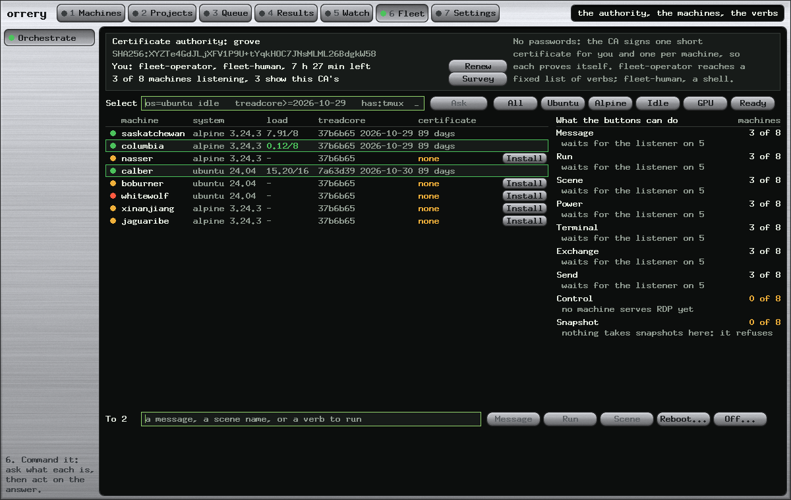
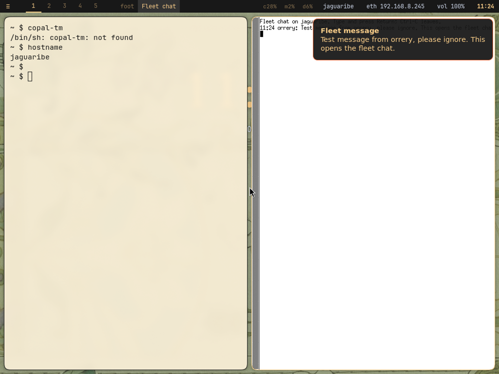
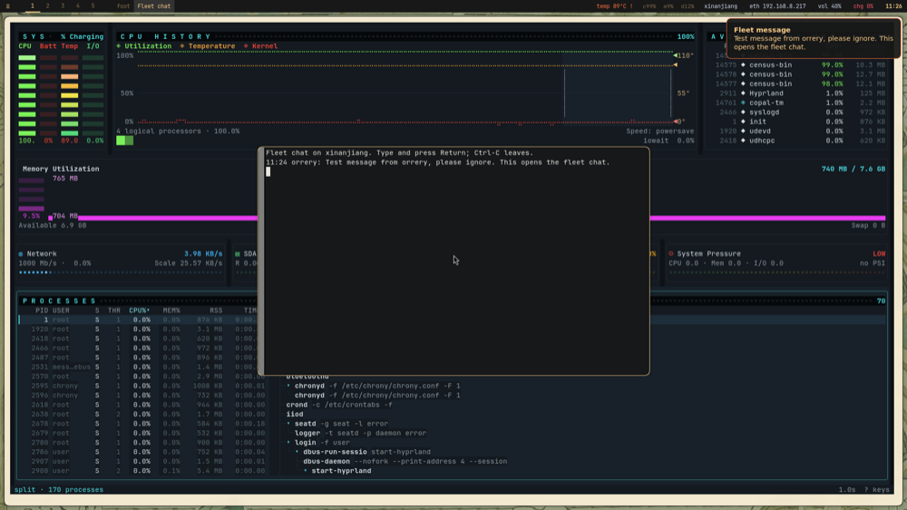
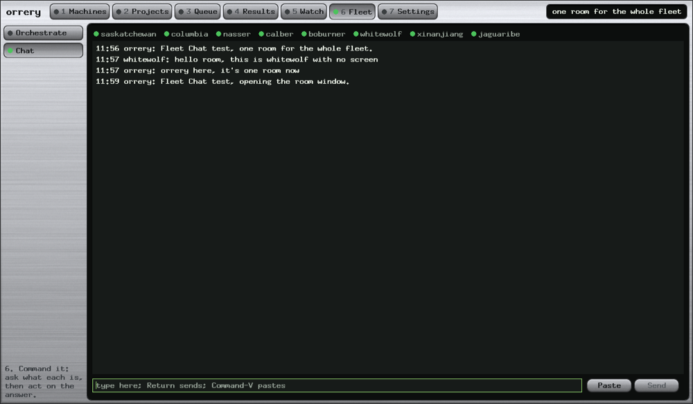
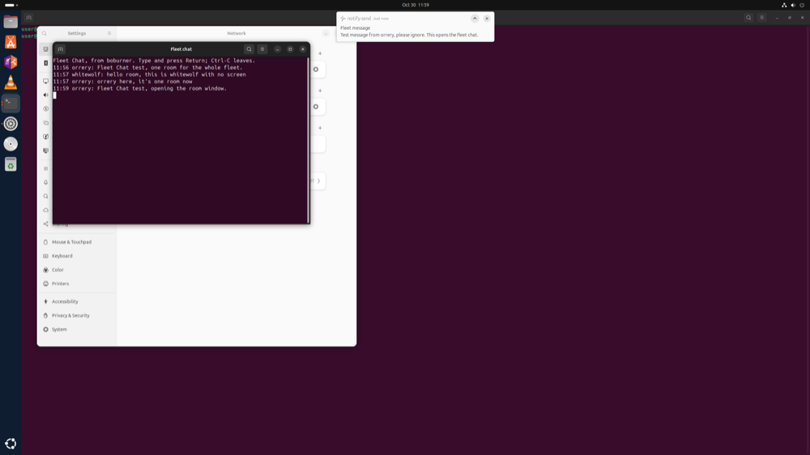

# Commanding the Fleet: How the Buttons Were Made to Work, Layer by Layer

*Lab Report — IEEE Format · 30 October 2026*

Copyright (c) 2026 Paul Richeson. MIT licensed, as orrery.

Companions: `src/orchestrate.rs` (the Fleet screen); `tools/orchestrate.py`,
`tools/fleet-select.py`, `tools/fleet-listener.sh`, `tools/fleet-exec.sh`;
the proofs `tools/fleet-listener-check.sh`, `tools/fleet-listener-live.sh`;
`copal fleet certify` in the Copal repository;
`docs/fleet-commanders-lab-report.md` (the history and the selection language).

---

## Abstract

Paul asked that the Lab's buttons be made to work, proved, and given "whole screen
dedicated to orchestrating and describes its capabilities and CA". This report is the
process: what was tried in what order, and what each step can and cannot claim.

- **The proof is layered, because the last layer needs a password nobody here has.**
  Each layer was run against real software in throwaway containers before any machine
  was touched: 77 checks of the listener against a real sshd, 25 tests of orrery's own
  ssh client against that sshd, and 25 checks of the Fleet screen's tool, on stock
  Alpine 3.22 and stock Ubuntu 24.04.
- **The riskiest question came out well.** orrery's hand-written client speaks one
  narrow profile and the listener leaves each machine's sshd as stock. They agree on
  both systems, with no change to the daemons' ciphers.
- **A rule of the project was broken and then restored.** The first recipe signed
  certificates from orrery, against `docs/lockdown.md` §5. Signing moved to a new
  `copal fleet certify`.
- **The Fleet screen exists:** the authority, each machine, what each button can do
  and why not, a question to select by, verbs to what lit, Install and Renew.
- **Not yet done:** the listener on the eight real machines. It is staged and needs
  the root password typed on each. **Control and Snapshot still do not work**, and the
  screen says so (§VI).

---

## I. Objective

A fleet commander is only as good as what stands behind its buttons. The objective
was not only working buttons but a way of *establishing* that they work, which a
person can repeat, and a screen where the state of it can be read at a glance.

## II. The Chain

Every button is the same five links. A failure anywhere reads as "the button does
nothing", so each link was proved on its own.

| # | Link | Fails as | Proved by |
|---|---|---|---|
| 1 | an operator's certificate from the CA | `no operator certificate` | `copal fleet login`; shown on the screen |
| 2 | the machine's host certificate from the same CA | client refuses the machine | listener check; the client's refusal tests |
| 3 | sshd accepts the certificate for that account | `Permission denied` | listener check |
| 4 | the forced command takes the verb | `refused: ...` | listener check |
| 5 | the verb does its work | the line it returns | listener check; the tool's checks |

## III. Procedure

### A. Reproduce

Message, from the Mac: `error: no operator certificate`. Link 1 was missing, and on
reading further links 2 to 5 were too. The design was in `copal-prep.sh` and had never
been deployed on these machines, some of which did not come from that stage at all.

### B. Build the node's half, and try to break it

`tools/fleet-listener-check.sh` installs the listener on a stock container, starts a
real sshd, and tries what must work and what must not. Refusals got as much attention
as verbs: a forced command that answers its verbs and also gives out a shell passes
every test of the verbs.

### C. Ask the question only a handshake can answer

Terminal, Exchange and Send do not use OpenSSH on the Mac. They use `src/ssh.rs`, a
hand-written client that insists on one key exchange, one cipher, and an Ed25519 host
certificate. It had only been tested against an sshd configured by `orrery
--profile-sshd`. The listener deliberately does not apply that profile: narrowing the
daemon would affect every other login. So: **does stock sshd offer what the client
insists on?**

`tools/fleet-listener-live.sh` answers with the app's own code on this Mac, through a
published port, against a sshd configured only by the listener. It asks for a shell on
a terminal, and it confirms the refusals: a machine that is not the one asked for, a
CA that is not ours, a certificate the CA did not sign.

### D. Drive the tool behind the screen

The same script then runs `tools/orchestrate.py` against the container: select by
system, version, package, fact, commit and date, each with a case that must select
nothing; send a message and read it back; a verb outside the list; a message with a
shell substitution in it.

### E. Keep the rule

Reading `docs/lockdown.md` for a reference turned up its plain sentence: orrery never
creates a credential. The recipe's stage step did. The Copal repository gained `copal
fleet certify`, which reads a public key on stdin and writes a certificate, and the
recipe now calls that and carries the file. It was caught by reading, and no test would
have found it.

### F. Draw it and look

A frame was rendered and read at each step, as `docs/` asks of anything that draws.
The first showed clipped machine names, versions and a clipped explanation, with every
test green.

## IV. Results

| Proof | Alpine 3.22 | Ubuntu 24.04 |
|---|---|---|
| Listener against real sshd (version 6) | 77 of 77 | 77 of 77 |
| orrery's client, listener-configured sshd (`ssh::live`, `sftp::`, `files::`) | 25 of 25 | 25 of 25 |
| The Fleet tool, end to end | 25 of 25 | 25 of 25 |

The real fleet, read-only: `orchestrate.py survey` read all eight machines, the CA's
fingerprint and the operator's certificate correctly, and reported no listener and no
host certificate on any. That is the truth today.

**What failed on the way, and it was all the harness:**

| Failure | Cause | Lesson |
|---|---|---|
| Listener check, 8 on Alpine and 2 on Ubuntu | a bad line added to `doas.conf`; a tty check expecting the wrong message; a forwarding check that sent nothing | a refusal test must push real traffic |
| "no sshd" on both | the fixture was in `/tmp`, which colima does not share | keep fixtures under home |
| Two navigation tests | they named six chapters | updated on purpose: the seventh is this screen |

**Copal's gate did not run.** `make lint` stops at its first step on this Mac, `sh -n
copal-prep.sh`, on bash syntax in a line this work did not touch; it fails the same with
the change set aside. `copal fleet certify` was checked by `dash -n` and by signing all
eight machines' certificates, not by the full gate, which should be run on Linux.

**What only the real screen found.** Install worked on six machines and then "stopped".
The button sat inside a clickable row, the row was asked second and took the press, so
only a click whose press and release fell in one frame reached Install; a slower one lit
the row. No container could show that. A test now clicks across two frames. The survey
also read every host certificate as absent, because `ssh-keyscan -c` prints no host
before the key: fixed, and read back from the real machines.

**An unexplained flake.** `sftp::` tests fail now and then, a different one each time, on
about one run in four while the Mac is busy; each passes alone. Their directories are
unique, so it is not the shared-path cause the backlog names. The cause is not known.

**What these containers cannot claim.** They are stock systems and not Paul's. Copal's
sshd has its own `AllowUsers` (handled and checked), a Hyprland desktop (the notification
is untested), and no real power-off has been run anywhere. `sftp::` and `files::` include
tests against a fake server, so Exchange and Send still want one run on a real machine.

## V. The Fleet Screen



*Figure 1. Sample data, to show the states. On the real fleet today all eight read amber.*

Chapter 6, between Watch and Settings, because it is the last step of the story: a
computer is added, given work, the work runs and is read, you look in, and you command.

- **The authority, on top,** because it decides everything below: the CA's fingerprint,
  whose certificate this is and how long it has, how many machines listen. Its border
  turns amber under thirty minutes. **Renew** runs `copal fleet login`.
- **The question.** The same words as `fleet-select.py`, read by the same code, so the
  two cannot drift. `os=ubuntu idle`, `treadcore>=2026-10-29`, `has:tmux`, `or`. The
  chips are the common ones.
- **The machines.** A lamp for the listener, system, load, the treadcore commit and date,
  the host certificate's days. A click lights one by hand. **Install** copies the recipe
  and types the command in that machine's Sessions tile, for the password.
- **What the buttons can do.** Each with how many machines can do it and, if not all, why.
- **The verbs,** to what is lit, one line back from each machine. Reboot and Off ask first.

The survey runs only while the screen is open: a console nobody is reading asks nothing.

### Message, Clip, Save and Chat

Listener version 3 changed what a message does. The Fleet screen offers **Update** on a
machine running an older one.

- **Message** is kept for the next login, as before; it also opens a chat window on a
  desktop, sends a notification, and writes a line on each terminal the user is logged
  in on, which says to answer with `fleet-chat`.
- **Chat is a terminal.** `fleet-chat` is one small program on every machine: a terminal
  is already input, paste and a scroll bar. A desktop gets it in a window (`xterm -sb`, or
  `gnome-terminal`); a headless machine's person runs it by hand. It cannot be opened on
  someone's tty unasked.
- **Clip** always writes `~/clipboard.txt`, the only clipboard a headless machine has, and
  the desktop's clipboard as well where there is one. It replaces that one file.
- **Save...** asks for a name and writes `~/fleet-inbox/NAME`. No paths, no dotfiles, no
  overwriting: it can add a file and change none.
- Clip and Save send what is typed, or the Mac's clipboard when nothing is, which is how
  several lines get there. 1 MiB at most.

**What the survey changed.** Copal keeps its session in `/tmp/xdg-runtime-1000`, with a
random bus address, so the first version's notification could never have fired there. Version 3
reads the environment from the session's own process.

**A new authority, stated plainly.** A `fleet-operator` certificate could run a fixed list
of verbs. It can now also put any text on a clipboard, which a person may then paste into a
shell, and add files to one directory. A held certificate is worth more than it was.

**Not proved by the containers.** They use stand-ins for the desktop. The real machines settled
most of it (below); the room across real machines waits for version 5 on them.

### On the Real Machines

The first test messages, sent at 11:24 on 30 October through the path the Message button
uses. These are the machines' own screens. They show the build of that morning, before the
window was made to float and before Fleet Chat became one room (below).



*Figure 2. jaguaribe, Copal on Hyprland. The chat window opened tiled, with tiny text, and
the notification covered its first line. None of that showed in a container.*


*Figure 3. boburner, Ubuntu 24.04 on GNOME: `gnome-terminal` with its scroll bar.*



*Figure 4. xinanjiang, after the fix, opened by hand with the new settings: floating, centred,
readable. Hyprland 0.54 had dropped the `windowrulev2` syntax of the first rule.*

A headless machine has no picture to take. whitewolf's terminal, in a tmux session, the reply
typed into the real `fleet-chat` by `tmux send-keys`:

```
Fleet chat on whitewolf. Type and press Return; Ctrl-C leaves.
18:24 orrery: Test message from orrery, please ignore. This opens the fleet chat.
18:27 whitewolf: hello from the headless machine, this is a real reply
18:27 orrery: got it, it's working. Thanks!
```

Note 18:27 against the Mac's 11:27: the room now has one clock. **Clip** was read back on the
real machines: `wl-paste` on jaguaribe and `xclip` on boburner returned the text, and
`~/clipboard.txt` and `~/fleet-inbox/fleet-test.txt` held it on whitewolf.

### Fleet Chat Is One Room

Paul, on seeing that: "its not 1 on 1. its Fleet Chat. perhaps orrery will host the history."
So listener version 5 replaces the per-machine chats.

- **orrery hosts the record,** `QUEUE/chat/room.log`, and a position for each machine. Every
  few seconds while orrery is open, one verb, `chat-sync`, gives a machine what it has not seen
  and takes what its person typed. While orrery is closed, lines wait in each machine's outbox.
- **The name and the time are written by orrery,** so no machine can speak as another.
- **A line is forgotten only when acknowledged,** so a dropped connection repeats and cannot lose.
- **Chat lines open nothing.** Message opens a window where it is sent; a Chat line just arrives
  in windows already open, or a fleet of eight would flash at every remark.
- **The poll is left out of the logs:** `copal-fleet.log`, sudo's journal and doas's log would
  otherwise gain a line per machine every four seconds.

**Proved across the real machines at 11:57.** A Message from orrery, a reply typed into the real
`fleet-chat` on headless whitewolf through tmux, and a line from orrery's Chat path arrived alike
on boburner, jaguaribe, xinanjiang and columbia, in order, under one clock.



*Figure 5. orrery's Chat page drawn from the room's real record: a lamp for each machine in reach.*


*Figure 6. xinanjiang, Copal: the same lines, including whitewolf's.*



*Figure 7. boburner, Ubuntu on GNOME.*

**A picture found a fault here too.** boburner's room file was right while its screen still showed a
window from the older version, reading an abandoned log, and because that window counted as open,
no new one came. Those test windows were closed by hand. The listener now closes them itself when it
updates, which has passed in containers and not yet run on a real machine.

**Shot** reads a screen: `grim` on Hyprland, `import` on boburner, the terminals' text on a
headless machine. `fleet-shot` does the same at a machine's own prompt, into `~/fleet-shots`.
It is the most private verb here, so it announces itself. **Every Shot from the console first
says "Hello, you are being observed."** in the room and on the screen, opening the chat window
where there is a desktop, and writing to the terminals where there is not; a moment later the
picture is taken, so the window is in it. The hello is in the forced command, on the machine,
where no console can leave it out, and no picture is taken if it could not be said. It is
logged as well. Timbuktu's Observe raised the same concern. `fleet-shot` at a machine's own
prompt says nothing, because nobody is being watched.

## VI. Discussion

**Why this order.** The expensive mistake would have been a bad `sshd_config` on eight
machines, some without a screen. Containers cost minutes, and they found no fault in the
listener; that is the outcome wanted, not a wasted effort. `sshd -t` and a reload rather
than a restart remain the last defence.

**Still open, in the order they matter:**

1. **The real install.** Fleet → Install, a password, eight times. Then each button once,
   on one machine of each kind, and this report extended with what happened.
2. **Certificates last 8 hours.** Renew is one press, and the screen warns. Whether a
   working fleet wants longer is Paul's decision: a longer one is a longer theft window.
3. **Control:** boburner can use GNOME's RDP; calber and whitewolf have no desktop; the
   five Copal machines need a Wayland server, or Control must learn VNC.
4. **Snapshot** refuses, on purpose. It needs a decision about filesystems first.
5. **Power on** needs a switched port or Wake-on-LAN, and `fleet.toml` does not exist here.
6. **The Lab and the Fleet screen select separately.** The Lab still picks by eye.
7. **Host certificates last 90 days,** and nothing renews them yet; the screen turns the
   count amber under 14 days.
8. **"Idle"** means nothing is running, and the queue keeps everything running.
