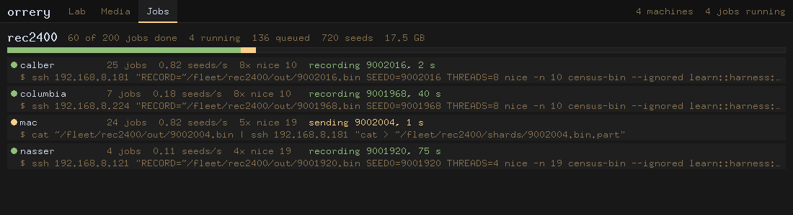

# fleet-train, and the Jobs view

*The fleet used as one computer: rounds of work on every spare CPU and the
GPU, each round judged, watched from the museum interface. First use:
training treadcore's learned tank on calber's CUDA card (treadcore's
LAB-REPORT-BRAIN.md sections 108 and 109; LAB-REPORT-FLEET.md).*

## Run it, on the coordinator (this Mac)

```sh
cd ~/code/treadcore
~/code/orrery/tools/fleet-train.sh run    scripts/fleet-train-stages.sh       # rounds until stopped
~/code/orrery/tools/fleet-train.sh run    scripts/fleet-train-stages.sh 1     # one round
~/code/orrery/tools/fleet-train.sh status scripts/fleet-train-stages.sh       # where it is
~/code/orrery/tools/fleet-train.sh stop   scripts/fleet-train-stages.sh       # after the round in hand
```

## Watch it

```sh
cd ~/code/orrery
cargo run --release -- --gui --demo \
  --jobs-cmd "cd ~/code/treadcore && ~/code/orrery/tools/fleet-train.sh status scripts/fleet-train-stages.sh --json"
```

Then **Jobs** in the header (Command-3). `--demo` is only for the Lab view
on a Mac without the `copal` CLI; the Jobs view reads the command. To watch
a recording run started by hand, put `RUNS=rec2400` in front of the
command. `--frame out.ppm --frame-view jobs --frame-state doc.json` draws a
saved document to a file, for review.



## What it is

| Piece | Where | What it does |
| --- | --- | --- |
| the loop | `tools/fleet-train.sh` (here) | rounds, stages in order, an event a line (`events.jsonl`), STOP, `status --json` |
| the stages | the project's (`treadcore/scripts/fleet-train-stages.sh`) | `stage_record`, `stage_train`, `stage_judge`, and `ft_detail` for the view |
| the recording | `treadcore/scripts/fleet-record.sh` | a queue of jobs claimed by `mv`, a lane a machine, shards streamed to the GPU node and hashed at both ends |
| the lanes as JSON | `treadcore/scripts/fleet-jobs.py` | each machine's job, state, age and the pipe it is running |
| the view | `src/jobs.rs`, the Jobs face | draws that document; it has no verbs |

## The rules it keeps

1. **The same read rule as every face.** The Jobs view draws one command's
   document and nothing else; a job that is not in it cannot be drawn.
2. **Watching and steering are two things.** The view has no verbs. The
   loop is started and stopped from a shell.
3. **A failure stops the loop.** A stage that fails ends the round as
   failed; the loop does not retry around it.
4. **A round's best is the loop's, not the project's.** treadcore's judge
   promotes a candidate only if the census, paired by seed on one binary,
   puts it above the best outside two standard errors, and even then the
   official net (`nets/map7.bin`) changes only when Paul says.
5. **Spare means spare.** The hosts file names each machine's threads and
   nice; a machine busy with its own work is left out.
