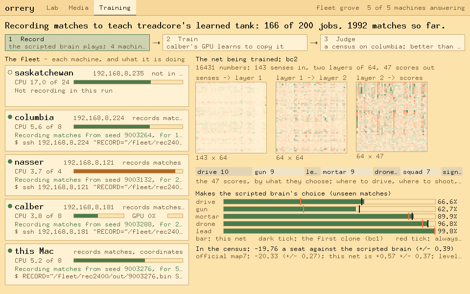

# fleet-train, and the Training view

*The fleet used as one computer: rounds of work on every spare CPU and the
GPU, each round judged, watched from the museum interface. First use:
training treadcore's learned tank on calber's CUDA card (treadcore's
LAB-REPORT-BRAIN.md sections 108 and 109; LAB-REPORT-FLEET.md).*

## Run it, on the coordinator (this Mac)

```sh
cd ~/code/treadcore
~/code/orrery/tools/fleet-train.sh run    scripts/fleet-train-stages.sh       # rounds until stopped
~/code/orrery/tools/fleet-train.sh run    scripts/fleet-train-stages.sh 1     # one round
~/code/orrery/tools/fleet-train.sh status scripts/fleet-train-stages.sh       # where it is
~/code/orrery/tools/fleet-train.sh stop   scripts/fleet-train-stages.sh       # after the round in hand
```

## Watch it: the Training view

```sh
cd ~/code/orrery
cargo run --release -- --gui --fleet grove --fleet-cmd "$HOME/.local/bin/copal fleet" \
  --training-cmd "python3 -I $HOME/code/orrery/tools/plans/treadcore-view.py"
```

The fleet is **grove**, the real one: saskatchewan, columbia, nasser and
calber, declared in `~/.copal/fleets/grove/nodes` (the Mac has no avahi, so
the list is written down). `copal fleet` on the Mac comes from
`make install-fleet` in copal-alpine-linux. The **Lab** view shows the four
machines as the fleet CLI sees them; they run no fleet agent yet, so their
tiles say "off bus" until they are enrolled.

**Training** (Command-4) is laid out to be read:

- **the top line** says what is happening, in a sentence, and the round's
  three steps light in turn: record, train, judge;
- **the fleet**, a card a machine: what it is for, its CPU load against its
  cores, calber's GPU, what it is doing now in words, and the command doing
  it;
- **the net being trained**: its three weight matrices as heat maps (green
  positive, red negative, stronger is larger, with a legend), **click one to
  enlarge it**: its axes say what the inputs and outputs are (the senses by
  group, the units, the scores by head), a legend runs from its most negative
  weight to its most positive, and the cell under the pointer reads out its
  weight; Escape or Close goes back. Then the 47 scores split into the
  heads they choose for, how often it makes the scripted brain's choice on
  matches it never saw (against the first clone and against always the
  commonest choice), and its census against the official net.



It reads one document, printed by `tools/plans/treadcore-view.py` every
5 s: each machine asked over ssh for its cores, load, memory and GPU; the
newest recording run's lanes; the loop's state; the best net's weights; its
results. `--frame out.ppm --frame-view training --frame-state doc.json`
draws a saved document, for review (`ORRERY_FRAME_ZOOM=N` with a matrix
enlarged). Text is drawn a pixel bolder than the font; `--thin` goes back.

## The queue: orrery runs treadcore's training (fleet-queue)

Orrery holds all of the orchestration (treadcore LAB-REPORT-BRAIN.md 112
and 113):
- **the engine,** `tools/fleet-queue.py`: the queue, a lane a machine, the
  keeper, the stops, sync and shutdown;
- **the plan,** `tools/plans/treadcore.py`: what the fleet does for
  treadcore, and how it gathers what came back;
- **the view,** `tools/plans/treadcore-view.py`: what the Training view
  draws.

treadcore keeps only the work itself: how one census plays
(`scripts/census.sh`), the brain's tests, the ledger and the fit
(`scripts/ledger.py`, `scripts/suggest.py`), and the trainer (`tools/bc`).

### 1. The standing queue, grove

`~/code/treadcore/build/queue/grove/` is the fleet's queue. It holds two
files.

**`config.json` says who works**, how each machine powers off for a
shutdown, and how often to gather:

```json
{"hosts": [
  {"name": "saskatchewan", "target": "user@192.168.8.235", "caps": ["cpu"], "nice": 10},
  {"name": "calber",   "target": "user@192.168.8.181", "caps": ["cpu", "gpu"], "nice": 10,
   "poweroff": "sudo -n /usr/bin/systemctl poweroff"},
  {"name": "mac",      "target": "-", "caps": ["cpu"], "nice": 19}],
 "planner": "python3 -I /Users/user/code/orrery/tools/plans/treadcore.py /Users/user/code/treadcore/build/queue/grove",
 "aliases": {"users-iMac": "mac", "users-iMac.lan": "mac", "iMac.lan": "mac"},
 "low_water": 7, "poll_s": 10, "sync_s": 1800}
```

**`plan.json` says what to train:**

```json
{"project": "~/code/treadcore",
 "commit": "origin/main",
 "census_host": "saskatchewan",
 "history": "build/ledger/fleet.tsv",
 "weights": {"seeds": 55, "secs": 900, "map": "all", "seed0": 20000000,
             "held_seeds": 400, "held_seed0": 60000000},
 "families": {"converge": ["build/fleet-sync/saskatchewan/converge/20261026-181011"], "queue": true, "batch": 8},
 "push": {"remote": "origin", "branch": "main"}}
```

- **`commit`.** `origin/main` is read again, after a fetch, at every
  top-up. So the fleet always works on the newest commit this Mac pushed.
  - Each machine builds each commit once, in `~/fleet/q-grove/c/SHORT/`.
  - Before building, a machine fast-forwards its own checkout
    (`~/code/treadcore`), when that checkout is clean and on main.
  - New jobs use the newest build. A job already planned runs on its own.
- **`history`.** The search starts from every census the fleet has read
  that shares the queue's settings (55 seeds or more, 900 s, every map)
  and today's `weights.rs`. A promotion changes `weights.rs`, so later
  trials are measured against the new defaults and are never mixed with
  the old.
- **`net`.** It adds rounds of the learned tank (see sections 3 and 4 of
  the first queue's settings in treadcore LR 110); grove has none for
  now.

### 2. Open it in orrery

```sh
cd ~/code/orrery && cargo run --release -- --gui --operator paul --fleet grove \
  --fleet-cmd "$HOME/.local/bin/copal fleet" --queue $HOME/code/treadcore/build/queue/grove
```

`--queue DIR` sets both what the Training view reads and what its buttons
run. Training is Command-4.

**The view shows:**
- the queue's state, in its top sentence;
- a bar of done (green), running (amber) and failed (red);
- the counts for each kind of job, the next job and the last finished;
- the last sync;
- what each machine is running.

**For an operator, the buttons are:**
- **Stop adding**, or **Resume adding** while draining;
- **Collect results and stop now**;
- **Start the queue**, when its keeper is not running;
- **Sync now:** gather every machine's record at once;
- **Shut the fleet down.** It asks twice, because the second press powers
  machines off:
  1. nothing new starts;
  2. each machine finishes the job in hand, and its results and its ledger
     come back;
  3. then it powers off;
  4. a report, `shutdown.json`, says who finished what and what never
     started. Its line is shown under the bar.

The same from a shell:

```sh
Q=~/code/treadcore/build/queue/grove; F="python3 $HOME/code/orrery/tools/fleet-queue.py $Q"
$F ensure; $F status; $F stop-adding; $F resume-adding; $F stop-now; $F sync; $F shutdown-now
```

### Push permission: what a template must have

A promotion reaches the project's main only by a push. With auto mode on
and push permitted, **Paul Accepts** a prepared promotion (his standing
word, 28 October) and it is pushed, as a fast-forward. Without permission,
or with auto mode off, it **self-modifies**: it goes onto the local line
`orrery/accepted` (main with the promotions not on it), every machine
builds that line from a git bundle sent with its build, and a `resolve`
flag asks Paul to commit the weights and nets (`git push origin
orrery/accepted:main`, or `$F resolve`). When main holds the line, the line
ends; when credentials come back, auto mode pushes it itself. Nothing
waits for a person. A template says where promotions land:

```json
"push": {"remote": "origin", "branch": "main"}
```

- **Checking.** Orrery checks the permission with a dry-run push of the
  remote's own head to that branch. That reaches the remote, proves the
  key, and changes nothing. It runs at every sync, before every promotion
  and before every approval, and the result is kept in `plan/push.json`.
- **On screen.** The Runs page shows it: green "push: ok to URL BRANCH", or
  red when it is not permitted.
- **Without it,** no promotion starts.
- **By hand:** `fleet-queue.py $Q push-check`.

treadcore's: `ssh://git@ssh.github.com:443/treadcore/treadcore.git main`,
from the Mac. A machine with no key that can push may still run the queue's
censuses, but not promote.

### The keeper, and flags: orrery runs itself

**Everything the fleet does runs inside orrery's keeper** (`fleet-queue.py
$Q ensure`, or Start the queue). No outside script waits on it. The band of
the Training view says what the keeper is doing: its pid, since when, the last
and next sync, and whether it is keeping this Mac awake.

On a Mac the keeper starts `caffeinate -dimsu -w PID`, which ends with the
keeper, so the Mac stays awake exactly while the queue runs. Set
`"keep_awake": false` in config.json to leave the Mac to its own settings.

**Flags.** When something needs a person, the keeper and the plan raise a
**flag**:
- a candidate under a family's floor;
- the local line to resolve (promotions self-modified, not on main), with
  the nets not committed;
- a run finished or failed;
- a machine lost;
- the breaker;
- push not permitted;
- a failed sync or planner;
- the shutdown report.

**Where flags show:**
- **In the window:** the Flags tab carries their count in red, and the Flags
  page lists them with Acknowledge and Acknowledge all.
- **On the command line:** `fleet-queue.py $Q flags [--all] [--brief]`, and
  `ack ID|all [--by NAME]`.
- **Files:** each flag is `$Q/flags/SEQ-KIND.json`, one a key.

**Progress is not a flag.** A trial past both held-out reads (a
**candidate**) is news, not a question: Paul accepts every one ("Just make
them visible, so I can see progress", 28 October). It is written as a
progress record (`"progress": true` in the same `flags/` folder), never waits
for an acknowledgement, and is not brought to the agent. It shows:
- **In the window:** the Candidates tab, its count in green, and the
  Candidates page: each one with its time, its two held-out reads and what
  it moves, newest first.
- **On the command line:** `fleet-queue.py $Q progress`.

### Settings: is it running as it should

**A lane with nothing it can start is the question, not the queue's length.**
On 28 October five CPU lanes sat idle under a queue of eleven: five builds
for whitewolf waiting behind its six-hour school job, and six of crucible's
segments queued for the GPU lanes. Eleven was above the low-water mark, so
the keeper asked for nothing. It now asks the planner every minute that any
lane has been idle with nothing it can start (`starve_s`, 60).

**The keeper restarts itself on new code.** That keeper had been running since
12:28 on 12:28's code, and the fix made at 14:29 waited all evening for its
next start. When `fleet-queue.py` changes on disk, the keeper restarts itself
in place (same pid, same caffeinate) once nothing running is older than
`restart_lose_s` (600). The jobs it cuts short go back on the queue. It does
not throw away a six-hour job just because its own code changed.

**Busy lanes are not a search that finds.** After w0034 became the defaults
(28 October, 14:20), trials ran ten times faster than before, and none of
the next 1,000 held out. Three causes, all fixed in the planner:
- **The fit read yesterday's censuses as today's.** 182 rows scored against
  the old defaults went into the fit, each near +2. The fit's "best" chased
  them and was read 309 times, at −0.3. The planner's own rows now pass the
  same `same_defaults` test as the history rows.
- **The same trial was asked for again and again.** suggest.py sees only what
  has been read, so each generation asked again for what was still queued:
  721 trials, 310 of them different, one read 77 times. The planner keeps
  what it has asked on these defaults (`state["search"]`; a promotion starts
  it anew). Each trial is asked once and a read again once more. The fit's
  best is asked again only after 20 new reads.
- **It never looked far.** Past `STALL` (150) trials since the last find (a
  trial past both its held-out reads), the search widens by itself. The
  fit's bound goes from 2 to 4, and half of each generation is wide trials:
  three weights at a time, each a quarter to four times its default, the
  ones the fit is least sure of the likelier. A find narrows it again.

The planner writes `plan/search.json`, which is the **search** check in
health. It turns amber once the search has been widened for 450 trials
with nothing found. By then the next gain needs a change to the brain
itself, not to its numbers.

**The window's sixth chapter, Settings:**
- **Keeper:** each check as a lamp and a sentence: the keeper, its heartbeat,
  its code against the file, planning, sync, caffeinate, the machines, idle
  lanes, and jobs waiting for one machine. Beside them are the buttons for
  what the keeper does not do by itself, or not yet:
  - **Plan now:** touches `runs/`, which every keeper plans on.
  - **Sync now.**
  - **Restart the keeper:** asks twice, and says which jobs will run again.
    A keeper from before self-restart is stopped from outside: its jobs are
    stopped on their hosts first, so they never run twice.
- **Commits:** the line the fleet builds, newest first. Each commit shows the
  `weights!` defaults it changed (old to new), when the fleet first built it,
  and whether it is on the local line only. Click one to open its page on
  GitHub. This is the planner's `plan/commits.json`, rewritten each time it
  plans.
- **On the command line:** `fleet-queue.py $Q health`, `plan-now`, `restart`.

**For an agent working with you** (Claude Code), a `UserPromptSubmit` hook
that runs `fleet-queue.py $Q flags --brief` puts every flag not yet
acknowledged in front of it with each message, so it needs no process of its
own to watch. treadcore's is in `.claude/settings.local.json`.

### 3. Gathering: sync

**The keeper runs `PLANNER sync` every `sync_s` seconds, and once more at
the end.** It gathers, with no command by hand:
1. Each machine's own ledger, read by `scripts/ledger.py` on that machine,
   so each row keeps its census binary's hash. The ledgers go to
   `~/code/treadcore/build/ledger/HOST.tsv`.
2. Each machine's converge records, without their binaries, into
   `build/fleet-sync/HOST/converge/`.
3. Every queue's own ledger.

**All of it is joined into `build/ledger/fleet.tsv`**, one row a machine
and census:
- rows are joined, never pooled: a census belongs to its machine;
- the Mac's names (users-iMac, users-iMac.lan) are one, by `aliases`;
- the last sync is in `build/ledger/sync.json`.

A machine that cannot be reached keeps the table it had.

### 4. What it found

All of it is under `$Q`:

| File | What it holds |
| --- | --- |
| `plan/summary.json` | written when the queue stops: every weight census and whether it passed, every net round, the best net, the families |
| `plan/ledger.tsv` | the queue's own censuses; `plan/history.tsv` the fleet's rows it also fits; `plan/ledger-all.tsv` both |
| `plan/families.json` | every candidate's families: each family's share, error and floor, and `holds` or `UNDER` |
| `plan/round-NNN.json`, `plan/best.bin` | net rounds, when the plan has them |
| `plan/state.json` | the planner's counters, and each commit seen with its `weights.rs` |
| `shutdown.json` | after a shutdown: each machine's last job, whether it reported, whether it is off; the jobs never started |
| `logs/ID.log`, `results/ID/` | each job's commands and output; what it brought back |
| `events.jsonl` | every start, finish, failure, requeue, sync, report and power-off |

**A weight trial that passes** is read twice more on 400 held-out seeds.
One that passes both is a candidate. Its families run next, with the
families of every converge run in `families.converge`, newest first, 8 to
a job side by side.

### 4a. Auto mode: the cycle closes itself

**Since 28 October the queue runs in auto mode** (config.json `"auto"`, on
unless `false`; `fleet-queue.py $Q auto on|off`, or the button on the
Candidates page). Paul: "Should self promote, unless we are not in AUTO
mode. We should be in auto mode." The cycle, with no one asked:

1. **Search.** The standing search plays weight trials, a census each, on
   every CPU; asked-for runs (spsa, tune, ...) go first.
2. **Adopt.** A finished spsa or tune run's result (`theta.weights`,
   `best.weights`) becomes a trial, its census and its two held-out reads
   queued together (`plan adopt FILE WHAT` does the same by hand).
3. **Hold out.** A trial past two errors is read twice on held-out seeds;
   past two errors on both, it is a **candidate** (news, on the Candidates
   page; nothing to answer).
4. **Families.** Every candidate's families are read; one under a floor is
   a flag.
5. **Promote.** The strongest *current* candidate whose families hold
   (current: its census and both reads ran on today's defaults, by each
   census's `COMMIT`) gets a promotion run. One at a time; each candidate
   tried once; two failures in a row pause auto mode with a flag.
6. **Paul Accepts.** The promotion's tests and full families pass on a
   branch; with push permitted, auto mode pushes it to main (a
   fast-forward) and tags it `brain-RID`. Without permission it
   self-modifies onto the local line, which the fleet builds, and a
   `resolve` flag stays up until main has it.
7. **Propagate.** Every machine's next top-up builds the new main and
   brings back the defaults it compiled. The promotion is **confirmed**
   machine by machine (Candidates page: `ok` confirmed, `..` building,
   `!!` differs or failed); confirmed on all, it is a progress record.
   Every candidate's families are read again on the new defaults.
8. **Again.** The search's history counts only censuses on the new
   defaults, and the search goes on from them.

With auto mode off, step 5 waits for a promotion asked by hand, and step 6
self-modifies (the Runs page's **To main** button pushes the local line).

**The rotation** (config `"rotation"`, on unless `false`;
`fleet-queue.py $Q rotation on|off`, or the button on the Runs page) is
auto mode's default work beside the standing search: one run of each
kind in turn, a run active in each of two lanes.

| Lane | In turn |
| --- | --- |
| brain | spsa, tune, census of `@best`, parts, switches, roundrobin, record |
| net | gauntlet, train, school (train and school can take days) |

- Each search gets fresh seeds (seed0 from 500,000,000, a million a
  turn), and record the next 48 seeds.
- parts, switches, roundrobin and gauntlet run once on each set of
  defaults.
- Rotation runs share the fleet with the search at normal priority; a run
  asked on the Runs page goes first.
- A search's result, and a passing census of `@best`, are adopted (step 2).
- A rotation run's lane is in its run file; `fleet-queue.py $Q runs`
  shows `by: rotation`.

**Flags and progress.** A flag asks a person: a run failed, a family
fell under its floor, a machine was lost, the breaker, push refused, auto
mode paused. Progress needs no one: a candidate, a run finished, a
promotion asked, approved, confirmed on every machine. The window shows
flags on the Flags tab, progress on Candidates.

**When the window closes.** The keeper is its own process (started by
`fleet-queue.py $Q start`, its parent launchd), so closing Orrery stops
nothing: the jobs, the syncs every `sync_s`, the plans and auto mode all go
on; the window only reads `status` and sends the buttons' commands.
Opening it again shows where the queue is.

### 5. When a machine goes away, joins, or must power off

- **A host that ssh cannot reach takes nothing.** Its lane says
  `unreachable` and probes it each minute.
- **A job that ended because ssh failed (255)** on a host that is then
  unreachable goes back on the queue for another host. It is not failed,
  and the breaker does not count it.
- **To take a host out,** delete it from `config.json`. Its lane ends after
  the job in hand.
- **From the window:** the Machines view (Command-3) adds a machine by its
  address, probes it, applies each recipe with a typed confirmation (the
  command typed into its Sessions tile, the password typed by you), and
  joins it. `tools/machines.py QUEUE status|probe|add|details|stage|join`
  is the same from a shell.
- **To make a new Ubuntu 24.04 machine a node,** `tools/fleet-node.sh` does
  it in one run on the machine (copy it with `cuda-node.sh`,
  `fleet-login.sh`, `topnotch.sh` and `fleet-poweroff-setup.sh`, then
  `sudo bash fleet-node.sh`): the build tools, Rust, the treadcore
  checkout over HTTPS, CUDA if it has an NVIDIA card (tmux and copal-tm
  either way), the topnotch login banner, and the power-off rule. It ends
  with the two lines for the coordinator: the host's entry for
  `config.json`, and its line for `~/.copal/fleets/FLEET/nodes` (orrery's
  Sessions).
- **To add one,** add it. Its lane starts, and builds the commit first. A
  host with `"caps": []` takes no work, but its record is still gathered.
- **To power off at a shutdown,** a host needs `poweroff`, a command it may
  run without a password. A host without it is left running, and the
  report says so. `tools/fleet-poweroff-setup.sh` writes the one rule that
  allows it: run it once on each machine.

## What it is

| Piece | Where | What it does |
| --- | --- | --- |
| the loop | `tools/fleet-train.sh` (here) | rounds, stages in order, an event a line (`events.jsonl`), STOP, `status --json` |
| the stages | the project's (`treadcore/scripts/fleet-train-stages.sh`) | `stage_record`, `stage_train`, `stage_judge`, and `ft_detail` for the view |
| the recording | `treadcore/scripts/fleet-record.sh` | a queue of jobs claimed by `mv`, a lane a machine, shards streamed to the GPU node and hashed at both ends |
| the queue | `tools/fleet-queue.py` (here) | jobs, a lane a machine, the keeper, stop adding, stop now, sync, shutdown |
| the plan for treadcore | `tools/plans/treadcore.py` (here) | prepares each commit on each machine; weight trials, held-out reads, families, net rounds; sync |
| the lanes as JSON | `tools/plans/treadcore-jobs.py` (here) | each machine's job, state, age and the pipe it is running |
| what is shown | `tools/plans/treadcore-view.py` (here) | the machines, the queue, the run, the loop, the net and its results, as one document |
| counting | `tools/plans/treadcore-count.py` (here) | the games, seat-ticks, thinks and training a queue has done |
| the view | `src/training.rs`, the Training face | draws that document; it has no verbs |

## The rules it keeps

1. **The same read rule as every face.** The Training view draws one command's
   document and nothing else; a job that is not in it cannot be drawn.
2. **Watching and steering are two things.** The view's buttons exist only
   for an operator (`--operator`), and only with a queue to drive.
3. **A failure stops the loop.** A stage that fails ends the round as
   failed; the loop does not retry around it.
4. **A round's best is the loop's, not the project's.** treadcore's judge
   promotes a candidate only if the census, paired by seed on one binary,
   puts it above the best outside two standard errors, and even then the
   official net (`nets/map7.bin`) changes only when Paul says.
5. **Spare means spare.** The hosts file names each machine's threads and
   nice; a machine busy with its own work is left out.
